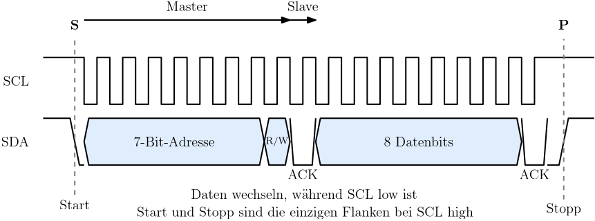

[⬅ Zurück zur Aufgabenstellung](README.md)

# I2C am MSP430

## Inhalt
- [Das Protokoll](#das-protokoll)
- [Open Drain und Pull-Ups](#open-drain-und-pull-ups)
- [Adressierung und Quittung](#adressierung-und-quittung)
- [Repeated Start](#repeated-start)
- [Umsetzung im MSP430: USCI im I2C-Mode](#umsetzung-im-msp430-usci-im-i2c-mode)
- [Register](#register)
- [Ablauf im Interrupt](#ablauf-im-interrupt)
- [Das bereitgestellte Modul](#das-bereitgestellte-modul)

**Family User Guide**
- Kapitel 38: USCI – I2C Mode *(im [Family Guide](https://e2e.ti.com/cfs-file/__key/communityserver-discussions-components-files/166/MSP430x6-Family-User-Guide.pdf) über das Inhaltsverzeichnis)*

---

## Das Protokoll

I2C (Inter-Integrated Circuit) ist wie SPI **synchron**, kommt aber mit zwei Leitungen für beliebig viele Teilnehmer aus:

| Signal | Richtung | Bedeutung |
|---|---|---|
| **SCL** | Master → Slaves | Takt |
| **SDA** | bidirektional | Daten |

<p align="center">
  
</p>

Die Anzahl der Leitungen bleibt bei zwei, egal wie viele Teilnehmer am Bus hängen. Bei SPI wächst sie mit jedem Slave um eine CS-Leitung. Dafür ist I2C langsamer und im Ablauf deutlich komplizierter.

Gültigkeitsregel: **SDA darf sich nur ändern, während SCL low ist.** Die einzigen Ausnahmen sind Start- und Stoppbedingung – und genau daran erkennt ein Teilnehmer sie.

| Bedingung | SCL | SDA |
|---|---|---|
| **Start** | HIGH | fallende Flanke |
| **Stopp** | HIGH | steigende Flanke |

---

## Open Drain und Pull-Ups

Beide Leitungen sind **Open Drain**: Ein Teilnehmer kann sie nur nach Masse ziehen, nicht aktiv auf High treiben. Den Ruhepegel stellen externe **Pull-Up-Widerstände** her.

Das hat drei Konsequenzen:

**Mehrere Teilnehmer dürfen gleichzeitig zugreifen**, ohne sich zu beschädigen. Zieht einer die Leitung nach Masse, während ein anderer sie loslässt, gewinnt immer die Masse. Diese Eigenschaft nutzt das Protokoll für die Quittung und für die Arbitrierung zwischen mehreren Mastern.

**Ohne Pull-Ups funktioniert gar nichts.** Die Leitungen bleiben dann auf undefiniertem Pegel, und der Bus meldet sich als dauerhaft belegt. Das ist beim Aufbau am Steckbrett der häufigste Fehler.

**Die Flankensteilheit begrenzt die Geschwindigkeit.** Der High-Pegel entsteht durch Umladen der Busleitung über den Pull-Up; kleinere Widerstände erlauben höhere Frequenzen, kosten aber mehr Strom. Typisch sind 4,7 kΩ für 100 kHz und 2,2 kΩ für 400 kHz.

| Modus | Bitrate |
|---|---|
| Standard Mode | 100 kHz |
| Fast Mode | 400 kHz |
| Fast Mode Plus | 1 MHz |

---

## Adressierung und Quittung

Statt einer Chip-Select-Leitung wird der Teilnehmer **adressiert**. Nach der Startbedingung sendet der Master ein Byte aus 7 Adressbits und einem R/W-Bit:

```
   7 Bit Adresse        R/W      ACK
 ┌──┬──┬──┬──┬──┬──┬──┬─────┬─────────┐
 │A6│A5│A4│A3│A2│A1│A0│ 0/1 │  Slave  │
 └──┴──┴──┴──┴──┴──┴──┴─────┴─────────┘
                        0 = schreiben
                        1 = lesen
```

Im **neunten Taktzyklus** gibt der Master SDA frei. Der angesprochene Teilnehmer zieht die Leitung auf Low – das ist das **ACK**. Bleibt sie high, liegt ein **NACK** vor: Niemand hat sich angesprochen gefühlt, oder der Teilnehmer kann gerade nicht.

Jedes weitere Byte wird ebenso quittiert. Beim Lesen quittiert der **Master**: Er bestätigt jedes empfangene Byte mit ACK, außer dem letzten – dort sendet er ein NACK, um dem Slave zu signalisieren, dass er aufhören soll zu senden.

> **Adressen mit und ohne Shift:** Die 7-Bit-Adresse steht in den oberen Bits des Adressbytes. Manche Datenblätter geben die Adresse bereits um ein Bit nach links geschoben an (8-Bit-Schreibweise), andere als reine 7-Bit-Zahl. Der MSP430 erwartet in `UCBxI2CSA` die **7-Bit-Variante**. Eine Adresse, die um den Faktor zwei danebenliegt, ist die zweithäufigste Fehlerursache nach den Pull-Ups.

---

## Repeated Start

Aus einem Register eines Slaves zu lesen erfordert zwei Schritte: erst die Registeradresse hinschreiben, dann die Daten abholen. Zwischen beiden darf der Bus **nicht freigegeben** werden – sonst könnte ein anderer Master dazwischenfunken und der Slave hätte vergessen, welches Register gemeint war.

Der Master sendet deshalb statt einer Stoppbedingung eine weitere **Startbedingung**, den *Repeated Start*, und adressiert denselben Teilnehmer erneut, diesmal mit gesetztem R/W-Bit:

```
S  [Addr+W]  ACK  [RegAddr]  ACK  Sr  [Addr+R]  ACK  [Data]  NACK  P
└── schreiben ──────────────────┘  └── lesen ──────────────────────┘
```

`S` = Start, `Sr` = Repeated Start, `P` = Stopp. Genau diesen Ablauf erzeugt `halI2CWriteRead()`.

---

## Umsetzung im MSP430: USCI im I2C-Mode

I2C beherrschen nur die USCI-Module der **B-Variante**. Auf dem Crazy Car ist **USCI_B0** als Master konfiguriert; die Pins P2.6 (SDA) und P2.7 (SCL) werden über den **Port-Mapping-Controller** auf das Modul gelegt.

Der Modus wird über `UCMODE_3` zusammen mit `UCSYNC` gewählt, der Master über `UCMST`:

```c
UCB0CTL1 |= UCSWRST;                        // Modul in Reset
UCB0CTL0  = UCMST | UCMODE_3 | UCSYNC;      // Master, I2C, synchron
UCB0CTL1  = UCSSEL__SMCLK | UCSWRST;        // Taktquelle, Reset halten
UCB0BR0   = br & 0xFF;
UCB0BR1   = br >> 8;
UCB0CTL1 &= ~UCSWRST;                       // freigeben
```

> **Port-Mapping:** Die `PxMAP`-Register sind schreibgeschützt und müssen über `PMAPKEYID` entsperrt werden; danach schließt sich das Fenster wieder. Sehen Sie sich in `halGPIO.c` an, wie das gelöst ist.

---

## Register

| Register | Relevante Bits | Bedeutung |
|---|---|---|
| `UCB0CTL0` | `UCMST` | Master-Betrieb |
| | `UCMODE_3` | I2C-Modus |
| | `UCSYNC` | synchron |
| | `UCSLA10` | 10-Bit-Adressierung, hier nicht verwendet |
| `UCB0CTL1` | `UCSSELx` | Taktquelle |
| | `UCTR` | `1` = Transmitter, `0` = Receiver |
| | `UCTXSTT` | Startbedingung senden |
| | `UCTXSTP` | Stoppbedingung senden |
| | `UCTXNACK` | NACK erzeugen |
| | `UCSWRST` | Software-Reset |
| `UCB0BR0/BR1` | – | Teiler für SCL |
| `UCB0I2CSA` | – | Slave-Adresse, 7 Bit |
| `UCB0STAT` | `UCBBUSY` | Bus ist belegt |
| `UCB0IE` | `UCTXIE`, `UCRXIE` | Datenrichtungen |
| | `UCNACKIE` | NACK melden |
| | `UCALIE` | Arbitration Lost |
| `UCB0IV` | – | Vektorregister mit Kennzahlen |

Das Vektorregister liefert unter anderem `USCI_I2C_UCNACKIFG`, `USCI_I2C_UCTXIFG` und `USCI_I2C_UCRXIFG` – dasselbe Muster wie `P1IV` aus Einheit 2.

Ein Detail, das beim Lesen des Codes auffällt: Das Setzen von `UCTXSTT` löst die Startbedingung samt Adressbyte aus, und das Modul meldet sich danach selbst über `UCTXIFG` zurück, um das erste Datenbyte abzuholen. Der Ablauf ist also nicht linear programmiert, sondern verteilt sich über mehrere Aufrufe derselben ISR.

---

## Ablauf im Interrupt

Die Serviceroutine ist ein **Zustandsautomat**. Welcher Zweig läuft, hängt davon ab, wie viele Bytes noch zu schreiben und zu lesen sind:

```
UCTXIFG  ─┬─ noch Bytes zu schreiben?   →  nächstes Byte in UCB0TXBUF
          │
          ├─ sollen danach Bytes gelesen werden?
          │     →  UCTR löschen, UCTXSTT setzen   (Repeated Start)
          │     →  Sonderfall ein einzelnes Byte: Stopp sofort anfordern
          │
          └─ sonst  →  UCTXSTP setzen, fertig

UCRXIFG  ─┬─ vorletztes Byte?  →  UCTXSTP vorher anfordern
          └─ Byte abholen, Zähler verringern, bei 0 fertig

UCNACKIFG →  UCTXSTP setzen, Übertragung abbrechen, Fehler melden
```

Zwei Stellen verdienen besondere Aufmerksamkeit:

**Der Ein-Byte-Sonderfall.** Soll genau ein Byte gelesen werden, muss die Stoppbedingung angefordert werden, *bevor* das Byte eintrifft – sonst sendet der Slave weiter. Das Modul wartet dafür kurz darauf, dass die Startbedingung abgeschlossen ist.

**Die NACK-Behandlung.** Ohne sie bleibt eine Übertragung an einen nicht vorhandenen Teilnehmer hängen, und der Bus bleibt belegt. Das Modul setzt in diesem Fall die Stoppbedingung, verwirft anstehende Flags und bricht komplett ab.

---

## Das bereitgestellte Modul

```c
void halUSCIB0Init(unsigned long baudrate);

unsigned char halI2CWrite(unsigned char addr, const unsigned char *data, unsigned char len);
unsigned char halI2CWriteRead(unsigned char addr, const unsigned char *wData, unsigned char wLen,
                              unsigned char *rData, unsigned char rLen);

unsigned char halI2CBusy(void);     // 1 = Übertragung läuft
unsigned char halI2CError(void);    // 1 = letzte Übertragung mit NACK abgebrochen
```

Beide Übertragungsfunktionen kehren **sofort** zurück – die Übertragung läuft danach im Hintergrund weiter. Der Rückgabewert sagt nur, ob der Auftrag angenommen wurde; ob er erfolgreich war, zeigen `halI2CBusy()` und `halI2CError()`.

Daraus ergibt sich das Benutzungsmuster:

```c
halI2CWriteRead(addr, cmd, 2, buf, 2);
while (halI2CBusy());                   // warten
if (halI2CError()) { /* kein Teilnehmer */ }
```

> **Achtung:** Die übergebenen Arrays müssen gültig bleiben, bis `halI2CBusy()` eine 0 liefert. Das Modul merkt sich den **Zeiger**, nicht den Inhalt.

---

[⬆ Zurück zur Aufgabenstellung](README.md)
