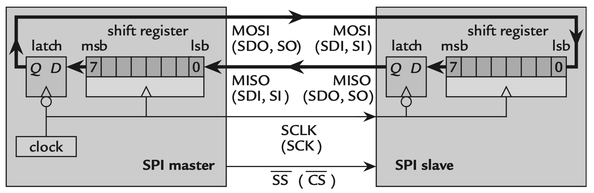
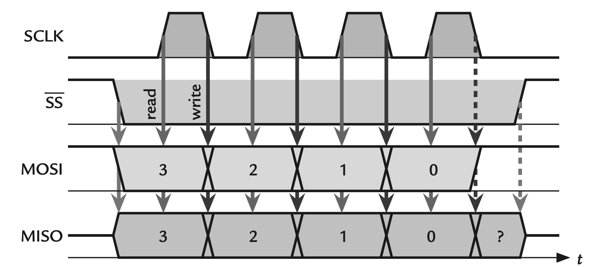
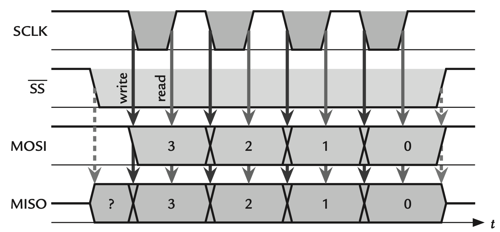

[⬅ Zurück zur Aufgabenstellung](README.md)

# SPI am MSP430

## Inhalt
- [Das Protokoll](#das-protokoll)
- [Taktphase und Polarität (CPOL, CPHA)](#taktphase-und-polarität-cpol-cpha)
- [Schieberegister](#schieberegister)
- [Umsetzung im MSP430: USCI im SPI-Mode](#umsetzung-im-msp430-usci-im-spi-mode)
- [Register](#register)
- [Takt und Teiler](#takt-und-teiler)
- [Ablauf einer Übertragung](#ablauf-einer-übertragung)

**Family User Guide**
- Kapitel 37: [USCI – SPI Mode](https://e2e.ti.com/cfs-file/__key/communityserver-discussions-components-files/166/MSP430x6-Family-User-Guide.pdf#page=968)
  - 37.2: [Introduction + Block Diagram](https://e2e.ti.com/cfs-file/__key/communityserver-discussions-components-files/166/MSP430x6-Family-User-Guide.pdf#page=970)
  - 37.3.3: [Master Mode](https://e2e.ti.com/cfs-file/__key/communityserver-discussions-components-files/166/MSP430x6-Family-User-Guide.pdf#page=973)
  - 37.5: [Registerbeschreibungen](https://e2e.ti.com/cfs-file/__key/communityserver-discussions-components-files/166/MSP430x6-Family-User-Guide.pdf#page=985)

---

## Das Protokoll

SPI (Serial Peripheral Interface) ist ein **synchrones** serielles Protokoll: Sender und Empfänger teilen sich eine Taktleitung, die der Master erzeugt. Damit entfällt jede Vereinbarung über Zeiten – der Empfänger weiß durch den Takt, wann ein Bit gültig ist.

Vier Leitungen:

| Signal | Richtung | Bedeutung |
|---|---|---|
| **SCLK** | Master → Slave | Takt |
| **MOSI** | Master → Slave | Master Out, Slave In |
| **MISO** | Slave → Master | Master In, Slave Out |
| **CS / SS** | Master → Slave | Chip Select, aktiv LOW |

<p align="center">
  
</p>

SPI ist **vollduplexfähig**: Bei jedem Taktimpuls wird gleichzeitig ein Bit gesendet und eines empfangen. Ein Sendevorgang erzeugt zwangsläufig auch ein empfangenes Byte – will man nur senden, wird das Empfangene verworfen.

Mehrere Slaves am selben Bus teilen sich SCLK, MOSI und MISO; jeder bekommt eine eigene CS-Leitung. Für *n* Teilnehmer braucht der Master also *3 + n* Leitungen.

---

## Taktphase und Polarität (CPOL, CPHA)

Zwei Parameter legen fest, wann ein Bit gültig ist:

- **CPOL (Clock Polarity)** – Ruhepegel des Takts: `0` = LOW, `1` = HIGH
- **CPHA (Clock Phase)** – Übernahme an der ersten (`0`) oder zweiten (`1`) Flanke

| Modus | CPOL | CPHA | Beschreibung |
|---|---|---|---|
| 0 | 0 | 0 | Takt idle LOW, Übernahme bei steigender Flanke |
| 1 | 0 | 1 | Takt idle LOW, Übernahme bei fallender Flanke |
| 2 | 1 | 0 | Takt idle HIGH, Übernahme bei fallender Flanke |
| 3 | 1 | 1 | Takt idle HIGH, Übernahme bei steigender Flanke |

<p align="center">
  
</p>
<p align="center"><em>CPOL = 0: Der Takt liegt zwischen den Übertragungen auf LOW.</em></p>

<p align="center">
  
</p>
<p align="center"><em>CPOL = 1: Der Takt liegt zwischen den Übertragungen auf HIGH. <strong>Dieser Fall gilt für das Display des Crazy Car.</strong></em></p>

Welcher Modus zu verwenden ist, steht im Datenblatt des Slave-Bausteins. Passen Master und Slave nicht zusammen, werden die Bits um eine halbe Taktperiode versetzt abgetastet – das Ergebnis sind Daten, die zufällig aussehen, obwohl die Leitungen in Ordnung sind.

> **Achtung, `UCCKPH` ist invers zu CPHA.** `UCCKPL` entspricht CPOL eins zu eins, `UCCKPH` aber **nicht** CPHA: TI beschreibt das Bit darüber, auf welcher Flanke das Bit *übernommen* wird, die übliche CPHA-Konvention darüber, auf welcher es *angelegt* wird. Das dreht die Bedeutung um:
>
> | | CPOL | CPHA | `UCCKPL` | `UCCKPH` |
> |---|---|---|---|---|
> | Modus 0 | 0 | 0 | 0 | 1 |
> | Modus 1 | 0 | 1 | 0 | 0 |
> | Modus 2 | 1 | 0 | 1 | 1 |
> | Modus 3 | 1 | 1 | 1 | 0 |
>
> Das Display des Crazy Car verlangt **Modus 3**: Takt im Ruhezustand HIGH, Übernahme an der zweiten Flanke. In Registerbits heißt das **`UCCKPL` gesetzt und `UCCKPH` gelöscht**.
>
> ```c
> UCB1CTL0 |=  UCCKPL;        // Takt idle HIGH
> UCB1CTL0 &= ~UCCKPH;        // Uebernahme an der zweiten Flanke
> ```
>
> Verlassen Sie sich im Zweifel auf die Registerbits, nicht auf die Modusnummer: Welche Zahl ein Datenblatt „Clock Phase" nennt, hängt davon ab, welche der beiden Konventionen es verwendet. Nachzulesen im *Family User Guide*, Kapitel 37, Registerbeschreibung `UCxxCTL0`.

---

## Schieberegister

Master und Slave besitzen je ein Schieberegister, und beide sind zu einem Ring verbunden. Pro Taktflanke rutscht ein Bit aus dem Master auf MOSI hinaus und gleichzeitig ein Bit von MISO in den Master hinein. Nach acht Takten haben beide Seiten ihren Inhalt getauscht.

Daraus folgt: **Senden und Empfangen sind nicht trennbar.** Wer ein Byte vom Slave lesen will, muss ein Byte senden – meist ein Dummy-Wert – um den Takt zu erzeugen, der die Daten herausschiebt.

---

## Umsetzung im MSP430: USCI im SPI-Mode

Der MSP430F5335 besitzt mehrere **USCI-Module** (Universal Serial Communication Interface). Die Varianten mit `A` beherrschen UART, IrDA und SPI, die mit `B` beherrschen SPI und I2C. Das Display des Crazy Car hängt an **USCI_B1**.

Ein USCI-Modul wird über das Bit `UCSYNC` zwischen asynchronem (UART) und synchronem Betrieb (SPI, I2C) umgeschaltet, und über `UCMODEx` wird innerhalb des synchronen Betriebs zwischen SPI und I2C gewählt.

> **Wichtig:** Alle Konfigurationsbits dürfen nur geändert werden, solange das Modul im Reset steht. Dafür gibt es `UCSWRST`: Erst setzen, dann konfigurieren, erst danach löschen. Wer das vergisst, bekommt ein Modul, das teilweise mit alten Einstellungen arbeitet.

```c
UCB1CTL1 |= UCSWRST;        // Modul in Reset
// ... Konfiguration ...
UCB1CTL1 &= ~UCSWRST;       // Modul freigeben
```

---

## Register

| Register | Relevante Bits | Bedeutung |
|---|---|---|
| `UCB1CTL0` | `UCCKPH` | Taktphase – **invers zu CPHA** |
| | `UCCKPL` | Taktpolarität (CPOL) |
| | `UCMSB` | `1` = MSB zuerst |
| | `UC7BIT` | `0` = 8 Datenbits |
| | `UCMST` | `1` = Master |
| | `UCMODEx` | Betriebsart, 3-Pin-SPI ohne STE |
| | `UCSYNC` | `1` = synchroner Modus |
| `UCB1CTL1` | `UCSSELx` | Taktquelle (SMCLK) |
| | `UCSWRST` | Software-Reset |
| `UCB1BR0/BR1` | – | Teiler für den Bittakt, 16 Bit |
| `UCB1STAT` | `UCBUSY` | Übertragung läuft |
| | `UCOE` | Overrun – empfangenes Byte wurde überschrieben |
| `UCB1TXBUF` | – | Sendepuffer, Schreiben löscht `UCTXIFG` |
| `UCB1RXBUF` | – | Empfangspuffer, Lesen löscht `UCRXIFG` |
| `UCB1IE` | `UCRXIE`, `UCTXIE` | Interruptfreigaben |
| `UCB1IFG` | `UCRXIFG`, `UCTXIFG` | Interrupt-Flags |
| `UCB1IV` | – | Vektorregister, Lesen löscht das höchstpriore Flag |

Die Zuordnung der Pins zu den Signalen SIMO, SOMI und CLK steht im gerätespezifischen Datenblatt bei den Port-Funktionen – dort ist auch nachzusehen, welches `PxSEL`-Bit die Sonderfunktion freischaltet.

> **Achtung bei der Benennung:** TI spricht nicht von MOSI und MISO, sondern von **SIMO** (Slave In, Master Out) und **SOMI** (Slave Out, Master In). Gemeint ist dasselbe.

---

## Takt und Teiler

Der Bittakt entsteht aus der gewählten Taktquelle und einem 16-Bit-Teiler:

$$f_{\text{SCLK}} = \frac{f_{\text{BRCLK}}}{\text{UCBRx}}$$

`UCBRx` setzt sich aus `UCB1BR0` (Low-Byte) und `UCB1BR1` (High-Byte) zusammen. Als Taktquelle dient hier SMCLK.

Anders als beim UART gibt es keinen Modulator – der Teiler ist ganzzahlig. Geht die gewünschte Frequenz nicht glatt auf, ergibt sich eine Abweichung. Bei SPI ist das unkritisch, weil der Takt mitübertragen wird: Der Slave folgt dem, was ankommt, solange seine im Datenblatt angegebene Maximalfrequenz nicht überschritten wird.

---

## Ablauf einer Übertragung

```
Byte in UCB1TXBUF schreiben
        │
        ▼
TX-Shift-Register übernimmt (wenn leer)  →  UCTXIFG wird wieder gesetzt
        │
        ▼
8 Taktflanken: Bit raus auf SIMO, Bit rein von SOMI
        │
        ▼
RX-Shift-Register voll  →  Byte nach UCB1RXBUF  →  UCRXIFG wird gesetzt
```

Für eine interruptgesteuerte Übertragung mehrerer Bytes ist das **RX**-Flag die richtige Quelle, nicht TX:

- `UCTXIFG` meldet, dass der *Sendepuffer* frei ist – das ist bereits der Fall, während das vorherige Byte noch auf der Leitung ist.
- `UCRXIFG` meldet, dass ein Byte *vollständig durchgelaufen* ist.

Wer auf `UCTXIFG` reagiert, schreibt das nächste Byte zu früh und zieht CS zu früh wieder hoch. Deshalb wird in dieser Übung der RX-Interrupt freigegeben und die ISR schreibt von dort aus das jeweils nächste Byte nach.

**Chip Select** gehört nicht zum USCI-Modul, sondern ist ein gewöhnlicher GPIO-Ausgang. Er wird vor dem ersten Byte auf LOW gezogen und erst nach dem letzten wieder auf HIGH – bei einer Übertragung von mehreren Bytes also nicht zwischendurch.

---

[⬆ Zurück zur Aufgabenstellung](README.md)
