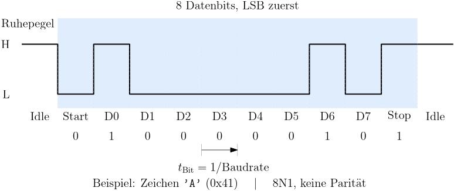

[⬅ Zurück zur Aufgabenstellung](README.md)

# UART am MSP430

## Inhalt
- [Das Protokoll](#das-protokoll)
- [Warum die Baudrate genau stimmen muss](#warum-die-baudrate-genau-stimmen-muss)
- [Zwei UARTs am Fahrzeug](#zwei-uarts-am-fahrzeug)
- [Umsetzung im MSP430: USCI im UART-Mode](#umsetzung-im-msp430-usci-im-uart-mode)
- [Register](#register)
- [Baudrate berechnen](#baudrate-berechnen)
- [Rahmenerkennung im Datenstrom](#rahmenerkennung-im-datenstrom)
- [Die bereitgestellten Module](#die-bereitgestellten-module)
- [Ein geteilter Zustand für zwei Module](#ein-geteilter-zustand-für-zwei-module)
- [Wer initialisiert den UART?](#wer-initialisiert-den-uart)

**Family User Guide**
- Kapitel 36: USCI – UART Mode *(im [Family Guide](https://e2e.ti.com/cfs-file/__key/communityserver-discussions-components-files/166/MSP430x6-Family-User-Guide.pdf) über das Inhaltsverzeichnis)*

---

## Das Protokoll

Der UART (Universal Asynchronous Receiver Transmitter) überträgt **asynchron**: Es gibt keine Taktleitung. Sender und Empfänger müssen sich vorab auf dieselbe Bitrate einigen, und der Empfänger rekonstruiert das Timing aus dem Signal selbst.

<p align="center">
  
</p>

Im Ruhezustand liegt die Leitung auf High. Ein Rahmen besteht aus:

| Teil | Pegel | Funktion |
|---|---|---|
| **Start-Bit** | LOW | fallende Flanke, an der sich der Empfänger synchronisiert |
| **Datenbits** | Daten | 7 oder 8 Bit, beim MSP430 standardmäßig LSB zuerst |
| **Paritätsbit** | optional | gerade oder ungerade Parität, hier nicht verwendet |
| **Stopp-Bit** | HIGH | bringt die Leitung zurück in den Ruhezustand |

Die Kurzschreibweise **8N1** bedeutet: 8 Datenbits, keine Parität (*None*), 1 Stopp-Bit.

Nach dem Start-Bit tastet der Empfänger jedes folgende Bit in seiner **zeitlichen Mitte** ab. Die Mitte wird aus der eigenen Baudrate hochgezählt – deshalb ist die fallende Flanke des Start-Bits der einzige Synchronisationspunkt innerhalb eines Rahmens.

Mit zwei Leitungen (TXD und RXD) ist der UART vollduplexfähig, allerdings immer nur zwischen genau zwei Teilnehmern. Eine Adressierung kennt das Protokoll nicht.

---

## Warum die Baudrate genau stimmen muss

Weicht der Empfängertakt ab, verschiebt sich der Abtastzeitpunkt mit jedem Bit weiter. Beim ersten Datenbit fällt eine kleine Abweichung nicht auf, am Stopp-Bit kann sie bereits neben dem Bit liegen.

Bei 8N1 sind zwischen Synchronisation und letztem Bit rund 9,5 Bitzeiten zu überbrücken. Damit die Abtastung in der zweiten Hälfte noch innerhalb des richtigen Bits liegt, gilt als Faustregel eine **Gesamtabweichung von etwa 2 %** – Sender und Empfänger zusammengenommen.

Genau deshalb wird der UART vom stabilen Quarztakt gespeist und nicht vom internen DCO.

---

## Zwei UARTs am Fahrzeug

Nur die USCI-Module der **A-Variante** beherrschen den asynchronen Betrieb. Auf dem Crazy Car sind zwei davon beschaltet, und beide sind in der Software vorbereitet:

| | **USCI_A0** | **USCI_A1** |
|---|---|---|
| Modul | `halUSCIA0` | `halUSCIA1` |
| Pins | P2.0 / P2.1 | P8.2 / P8.3 |
| Weg zum PC | eZ-FET-Backchannel des Debuggers, virtueller COM-Port | Steckerpins, z. B. für ein Bluetooth-Modul |
| Port-Mapping nötig | ja (`P2MAP0`, `P2MAP1`) | nein, feste Pinfunktion |
| Baudrate im Projekt | 57600 | 9600 |
| Kabel nötig | nur USB zum Debugger | keines, sobald BT-Modul gesteckt |

Der Debug-UART ist der bequemere Weg: Er läuft über dasselbe USB-Kabel wie der Debugger, und am PC erscheint ein COM-Port. Sobald das Fahrzeug aber fährt, hängt es an keinem Kabel mehr – dann wird die Telemetrie über ein Bluetooth-Modul am AUX-UART gebraucht.

Beide Module bieten **dieselbe Schnittstelle** an, nur mit anderem Namenspräfix:

```c
halUSCIA0Init()   ·  halUSCIA0Start()   ·  halUSCIA0Send()   ·  halUSCIA0TxBusy()   ·  halUSCIA0GetFrame()
halUSCIA1Init()   ·  halUSCIA1Start()   ·  halUSCIA1Send()   ·  halUSCIA1TxBusy()   ·  halUSCIA1GetFrame()
```

Das ist Absicht: Der Driver Layer soll zwischen beiden umschalten können, ohne dass sich an seinem eigenen Code etwas ändert. Wie das gemacht wird, sehen Sie in Einheit 7 – dort gibt es dafür einen Satz Makros, die zur Übersetzungszeit auf das eine oder andere Modul zeigen.

> **Warum das hier schon steht:** Zwei Module mit identischer Schnittstelle sehen nach Redundanz aus. Sie sind aber der Grund, warum der Driver Layer später nichts davon wissen muss, über welchen Weg seine Daten gehen.

---

## Umsetzung im MSP430: USCI im UART-Mode

Der asynchrone Betrieb wird über `UCSYNC = 0` gewählt. Wie bei allen USCI-Modulen gilt: Konfiguration nur im Reset, also zwischen Setzen und Löschen von `UCSWRST`.

> **Zur Benennung:** Die Pins heißen aus Sicht des Hosts `DEBUG_TXD` und `DEBUG_RXD`. Der mit `TXD` beschriftete Pin ist am Controller folglich ein **Eingang** (`UCA0RXD`). Wer nach dem Namen geht statt nach der Beschaltung, vertauscht die beiden.

**Port-Mapping beim Debug-UART.** P2.0 und P2.1 haben keine feste UART-Funktion – sie werden über den Port-Mapping-Controller auf das Modul gelegt:

```c
PMAPKEYID = PMAPKEY;            // Schreibzugriff freigeben
P2MAP0 = PM_UCA0RXD;
P2MAP1 = PM_UCA0TXD;
PMAPKEYID = 0;                  // wieder sperren
```

Beim AUX-UART entfällt das: P8.2 und P8.3 tragen die UCA1-Funktion fest, dort genügt `P8SEL`.

---

## Register

| Register | Relevante Bits | Bedeutung |
|---|---|---|
| `UCA0CTL0` | `UCPEN` | Paritätsbit aktivieren |
| | `UCPAR` | gerade / ungerade Parität |
| | `UCMSB` | `0` = LSB zuerst |
| | `UC7BIT` | `0` = 8 Datenbits |
| | `UCSPB` | `0` = ein Stopp-Bit |
| | `UCSYNC` | `0` = asynchron |
| `UCA0CTL1` | `UCSSELx` | Taktquelle (SMCLK) |
| | `UCSWRST` | Software-Reset |
| `UCA0BR0/BR1` | – | ganzzahliger Teiler, 16 Bit |
| `UCA0MCTL` | `UCBRSx` | Modulator, Nachkommaanteil in Achteln |
| | `UCBRFx`, `UCOS16` | Oversampling-Modus, hier nicht verwendet |
| `UCA0STAT` | `UCFE` | Framing Error – Stopp-Bit lag nicht auf High |
| | `UCOE` | Overrun – Byte wurde nicht rechtzeitig abgeholt |
| | `UCPE` | Parity Error |
| | `UCBUSY` | Übertragung läuft |
| `UCA0TXBUF` | – | Sendepuffer |
| `UCA0RXBUF` | – | Empfangspuffer |
| `UCA0IE` | `UCRXIE`, `UCTXIE` | Interruptfreigaben |
| `UCA0IV` | – | Vektorregister |

Die Statusbits `UCFE`, `UCOE` und `UCPE` sind diagnostisch wertvoll: Ein gesetztes `UCFE` deutet fast immer auf eine falsche Baudrate hin, ein gesetztes `UCOE` darauf, dass die ISR zu selten läuft.

---

## Baudrate berechnen

Aus Taktquelle und gewünschter Baudrate ergibt sich ein meist nicht ganzzahliger Teiler:

$$N = \frac{f_{\text{BRCLK}}}{\text{Baudrate}}$$

Der ganzzahlige Anteil kommt in `UCA0BR0` und `UCA0BR1`, der Rest wird über den **Modulator** angenähert. `UCBRSx` gibt an, in wie vielen von acht Bitzeiten der Teiler um eins erhöht wird – im Mittel entsteht so ein gebrochenes Teilerverhältnis.

$$\text{UCBRx} = \lfloor N \rfloor \qquad \text{UCBRSx} = \text{round}\big((N - \lfloor N \rfloor) \cdot 8\big)$$

Im bereitgestellten Modul steht genau diese Rechnung:

```c
unsigned int  brScaler    = SMCLK_FREQU / baudrate;
unsigned char brDecPlaces = ((SMCLK_FREQU % baudrate) * 8) / baudrate;

UCA0BR0  = brScaler & 0xFF;
UCA0BR1  = brScaler >> 8;
UCA0MCTL = brDecPlaces << 1;        // UCBRSx liegt ab Bit 1
```

**Rechnen Sie das für Ihre Taktfrequenz und 57600 Baud nach** – Sie brauchen die Zahlen für die Messung am Analog Discovery.

---

## Rahmenerkennung im Datenstrom

Der UART überträgt einen fortlaufenden Zeichenstrom. Wo eine Nachricht beginnt, steht **nicht** im Protokoll – das Start-Bit markiert nur den Anfang eines Bytes, nicht den Anfang eines Datensatzes.

Wer mehr als einzelne Zeichen überträgt, braucht deshalb eine Verabredung auf höherer Ebene. Üblich sind:

- ein **Sync-Muster** am Anfang, also eine Bytefolge, die den Rahmenbeginn markiert
- eine **feste Rahmenlänge**, sodass klar ist, wann der Datensatz vollständig ist
- optional eine **Prüfsumme** am Ende

Das bereitgestellte Modul verwendet die ersten beiden: Der Empfänger verwirft eintreffende Zeichen, bis die vereinbarte Sync-Folge erkannt ist, und sammelt danach genau `frameLen` Bytes.

Der Sonderfall, über den man dabei stolpert: Passt ein Zeichen nicht zum erwarteten Sync-Byte, könnte es trotzdem selbst der *Beginn* einer neuen Sync-Folge sein. Wer in diesem Fall einfach auf Position 0 zurücksetzt, verliert jeden zweiten Rahmen.

---

## Die bereitgestellten Module

```c
void halUSCIA0Init(unsigned int baudrate);

// Empfangen
void halUSCIA0Start(const unsigned char *sync, unsigned char syncLen, unsigned char frameLen);
void halUSCIA0Stop(void);
unsigned char halUSCIA0RxComplete(void);                // 1 = Rahmen vollständig
unsigned char halUSCIA0GetFrame(unsigned char *dest);   // kopiert den Rahmen, gibt ihn frei

// Senden
unsigned char halUSCIA0Send(const unsigned char *data, unsigned char length);   // 0 = Sender beschäftigt
unsigned char halUSCIA0TxBusy(void);
```

`halUSCIA1` bietet dieselben Funktionen mit dem Präfix `halUSCIA1` an.

Nach `halUSCIAxInit()` ist der Empfang zunächst **aus**. Er wird erst mit `halUSCIAxStart()` eingeschaltet, und zwar zusammen mit der Angabe, worauf gewartet werden soll.

> **Achtung:** Die übergebenen Arrays müssen gültig bleiben, bis die Übertragung abgeschlossen ist. Das Modul merkt sich den **Zeiger**, nicht den Inhalt. Eine lokale Variable in einer Funktion, die vorher zurückkehrt, führt zu Datenmüll auf der Leitung – und zu einem Fehler, der sich nur sporadisch zeigt.

Beide Richtungen laufen über dieselbe ISR, unterschieden über `UCAxIV`. Der Sende-Interrupt wird beim Anstoßen einer Übertragung freigegeben und am Ende wieder abgeschaltet – sonst würde er dauerhaft feuern, weil ein leerer Sendepuffer immer eine Anforderung bedeutet.

---

## Ein geteilter Zustand für zwei Module

Hier liegt die Besonderheit der beiden UART-Module, und sie hat Folgen für die Benutzung.

Empfangspuffer, Schreibposition, Sync-Zeiger und Sendezeiger liegen **nicht** in den Modulen selbst, sondern in einer gemeinsamen Datei:

```c
/* halSharedUART.h */
volatile unsigned char uartRxArray[UART_RX_MAX];
volatile unsigned char uartRxComplete = 0;
unsigned char uartRxPos = 0;
const unsigned char *uartSync = 0;
unsigned char uartSyncLen  = 0;
unsigned char uartFrameLen = 0;
volatile const unsigned char *uartTxPtr = 0;
volatile unsigned char uartTxLen = 0;
```

Beide Module greifen per `extern` darauf zu. Daraus folgen zwei Dinge:

**Die Datei darf nur an genau einer Stelle inkludiert werden.** Sie *definiert* die Variablen, sie deklariert sie nicht nur. Ein zweites `#include` in einer anderen `.c`-Datei erzeugt dieselben Symbole ein zweites Mal, und der Linker bricht mit einem Duplikat ab. Im Projekt steht das `#include` deshalb ausschließlich in `halGeneral.c`.

**Es kann immer nur ein UART aktiv sein.** Würden beide gleichzeitig empfangen, schrieben sie in denselben Puffer und überschrieben sich gegenseitig die Schreibposition. Das Ergebnis wären Rahmen, die mal ankommen und mal nicht.

Für dieses Fahrzeug ist das kein Verlust – Debug-Ausgabe über USB und Telemetrie über Bluetooth werden ohnehin nie zugleich gebraucht. Es ist eine bewusste Entscheidung zugunsten des Speichers: Ein Empfangspuffer statt zweier, und die Umschaltung kostet keine Laufzeit, weil sie zur Übersetzungszeit passiert.

> **Zu beantworten:** Was müsste man ändern, damit beide UARTs gleichzeitig laufen können? Was kostet das an RAM?

---

## Wer initialisiert den UART?

In dieser Einheit rufen Sie `halUSCIA0Init()` und `halUSCIA1Init()` in `halInit()` auf, wie jedes andere HAL-Modul auch.

Im fertigen Fahrzeug steht die Initialisierung an anderer Stelle: im **Driver Layer**. Der Grund folgt aus dem geteilten Zustand – welcher der beiden UARTs mit welcher Baudrate läuft, entscheidet die Anwendung, nicht die Hardwareschicht. `halInit()` müsste sonst eine Entscheidung treffen, die ihm nicht zusteht.

```
main()
  └─ halInit()        →  GPIO, Takt, Timer, SPI, I2C, ADC, DMA  ... und in Einheit 5 auch die UARTs
  └─ driverInit()     →  ab Einheit 7: der UART, mit der dort gewählten Baudrate
```

Ab Einheit 7 übernimmt ein Modul des Driver Layers die Umschaltung: Ein einziges `#define` legt fest, ob die Telemetrie über USB oder über Bluetooth geht, und der übrige Code merkt davon nichts. Dann wandert der Init-Aufruf aus `halInit()` dorthin.

Das ist die einzige Stelle im Projekt, an der ein HAL-Modul nicht in `halInit()` initialisiert wird – und sie ist leicht zu übersehen.

---

[⬆ Zurück zur Aufgabenstellung](README.md)
