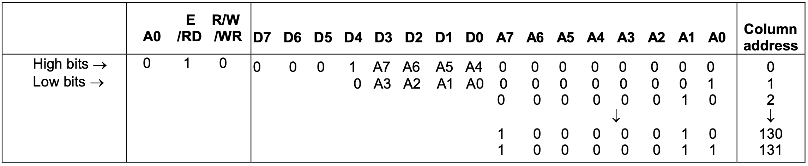
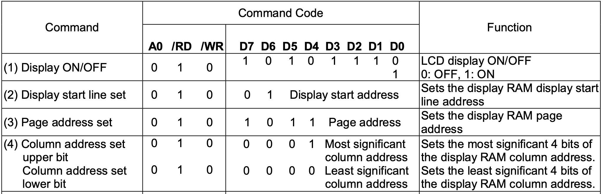
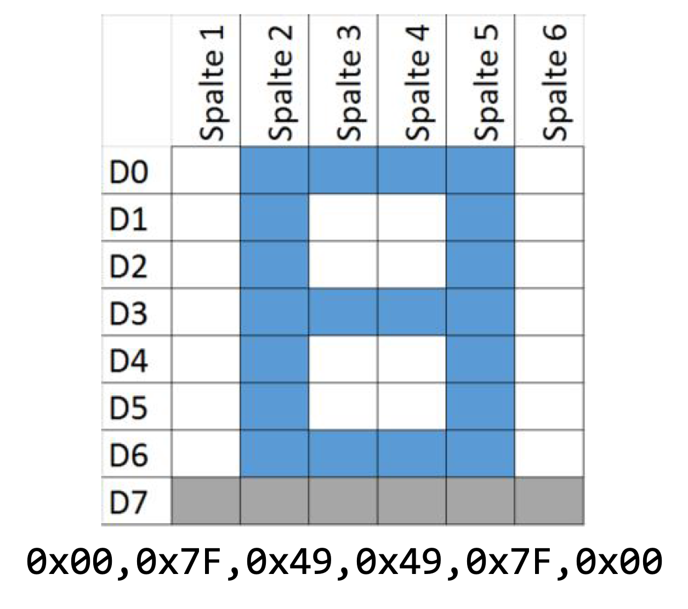

[⬅ Zurück zur Aufgabenstellung](README.md)

# Das Display am SPI

## Inhalt
- [Was der Controller kann](#was-der-controller-kann)
- [Befehl oder Bildpunkt](#befehl-oder-bildpunkt)
- [Seiten und Spalten](#seiten-und-spalten)
- [Die Initialisierungssequenz](#die-initialisierungssequenz)
- [Zeichen aus der Fonttabelle](#zeichen-aus-der-fonttabelle)
- [Fehlerbilder](#fehlerbilder)
- [Was vorgegeben ist](#was-vorgegeben-ist)

**Unterlagen**
- [ST7565 Dot Matrix LCD Controller](https://www.hpinfotech.ro/ST7565.pdf)
  - Seite 13: MPU-Interface, serielle Ansteuerung
  - Seite 15: Display Data RAM
  - Seiten 32–41: Befehlstabelle

---

## Was der Controller kann

Das Display hat 128 × 64 Bildpunkte und keinerlei Eigenintelligenz. Es kennt keine Zeichen, keine Zahlen und keine Zeilen – es kennt **Bytes im Bildspeicher**. Alles andere macht Ihr Treiber.

Angesteuert wird es über die SPI-Schnittstelle, die Sie in Einheit 5 geschrieben haben. Damit ist das Display der erste sichtbare Nutzen Ihres eigenen HAL-Moduls: Was bisher am Analog Discovery als Rechteckmuster zu sehen war, wird jetzt zu Text auf einer Anzeige.

---

## Befehl oder Bildpunkt

Über SPI kommen nur Bytes – der Controller muss trotzdem unterscheiden, ob ein Byte ein **Befehl** oder **Bilddaten** sind. Dafür gibt es eine zusätzliche Leitung, die der ST7565 **A0** nennt und die in anderen Datenblättern D/C heißt:

| A0 | Bedeutung des Bytes |
|---|---|
| `0` | Befehl – Position setzen, Kontrast, Display ein |
| `1` | Bilddaten – acht Bildpunkte übereinander |

Die Leitung ist ein gewöhnlicher GPIO-Ausgang und muss **vor** dem Senden umgeschaltet werden, nicht mittendrin. Dafür richten Sie im HAL zwei Funktionen ein – das ist die [erste Aufgabe](README.md#aufgabe-a0--und-reset-leitung-setzen) dieser Einheit:

```c
halSetLCDCmd();     // A0 = 0
halSetLCDData();    // A0 = 1
```

Daraus ergibt sich der Weg jedes Bytes zum Display: warten, bis die vorige Übertragung fertig ist → A0 setzen → Bytes in den SPI-Puffer → Übertragung anstoßen. Dieser Weg ist in `driverLCD.c` vorgegeben und ruft die beiden Funktionen oben auf. Fehlen sie, lässt sich das Modul nicht übersetzen.

---

## Seiten und Spalten

Der Bildspeicher ist nicht als Fläche organisiert, sondern in **acht Seiten zu je 128 Spalten**. Eine Seite ist acht Bildpunkte hoch; ein geschriebenes Byte füllt also eine Spalte einer Seite, mit dem niederwertigsten Bit oben.

```
        Spalte 0   1   2  ...  127
Page 0  [ 8 Pixel hoch ]           ← Bit 0 oben, Bit 7 unten
Page 1
...
Page 7
```

Nach jedem geschriebenen Byte rückt der interne Spaltenzähler **selbsttätig** eine Position weiter. 128 Bytes hintereinander füllen also eine ganze Seite, ohne dass die Position dazwischen neu gesetzt werden muss. Am Zeilenende springt der Zähler aber **nicht** in die nächste Seite – dort muss der Treiber eingreifen.

Die Position wird mit drei Befehlsbytes gesetzt, und die Spaltenadresse ist dabei auf zwei davon aufgeteilt:

| Byte | Inhalt |
|---|---|
| 1 | `SET_PAGE` + Seitennummer (0 … 7) |
| 2 | `MSB_COL_ADDR` + obere vier Bit der Spalte |
| 3 | `LSB_COL_ADDR` + untere vier Bit der Spalte |

<p align="center">
  
</p>

Der Grund für die Aufteilung ist das Befehlsformat: In einem Befehlsbyte stehen nur vier Bit für den Wert zur Verfügung, die oberen vier kennzeichnen, um welchen Befehl es sich handelt. Eine Spaltenadresse von 0 bis 127 braucht sieben Bit und passt deshalb nicht in ein einzelnes Byte.

In Code sind das drei Zeilen, und genau so steht es vorgegeben in `driverLCDSetPosition()`:

```c
pos[0] = SET_PAGE     + page;           // Seite 0 .. LCD_MAX_ROW
pos[1] = MSB_COL_ADDR + (col >> 4);     // obere vier Bit der Spalte
pos[2] = LSB_COL_ADDR + (col & 0x0F);   // untere vier Bit der Spalte
```

`col >> 4` schiebt die oberen vier Bit nach unten, `col & 0x0F` blendet alles außer den unteren vier aus. Beide Hälften werden auf das jeweilige Befehlsmakro addiert – das ist der ganze Trick. Rechnen Sie es für Spalte 127 einmal von Hand nach, dann ist klar, warum das Display sonst in der falschen Spalte schreibt.

---

## Die Initialisierungssequenz

Nach dem Einschalten ist der Controller in einem undefinierten Zustand. Neun Befehle bringen ihn in Betrieb:

<p align="center">
  
</p>

```c
LCD_RESET, LCD_BIAS, ADC_SEL_NORMAL, COMMON_REVERSE, RES_RATIO,
ELEC_VOL_MODE, ELEC_VOL_VALUE, POWER_CONT, DISPLAY_ON
```

Diese Folge lässt sich nicht herleiten – sie steht im Datenblatt und hängt davon ab, wie das Panel auf der Platine verbaut ist. `ADC_SEL_NORMAL` und `COMMON_REVERSE` legen zum Beispiel fest, in welcher Richtung Zeilen und Spalten laufen; mit den falschen Werten steht die Anzeige auf dem Kopf oder spiegelverkehrt. **Deshalb ist die Initialisierung vorgegeben.**

Zwei Dinge daran sind trotzdem erwähnenswert:

**Vor der Sequenz kommt ein Hardware-Reset** über eine eigene Leitung, mit 25 ms Wartezeit. Der Befehl `LCD_RESET` allein genügt nicht, wenn der Controller noch gar nicht auf Befehle reagiert.

**`ELEC_VOL_VALUE` ist der Kontrast.** Wenn die Anzeige blass oder komplett schwarz ist, liegt es in neun von zehn Fällen an diesem einen Wert – nicht an Ihrem Treiber.

---

## Zeichen aus der Fonttabelle

Der Controller kennt keine Schrift. Ein Zeichen ist eine Folge von Spaltenbytes, und die stehen in einer Tabelle:

```c
const unsigned char font_table[128][6];
```

<p align="center">
  
</p>

Der Index ist der **ASCII-Code** des Zeichens, die sechs Bytes sind seine Spalten. Ein `'A'` auszugeben heißt also: `font_table['A']` holen und die sechs Bytes als Bilddaten senden.

Damit sind Textausgabe und Zahlendarstellung reine Programmieraufgaben – und genau deshalb schreiben Sie sie selbst:

- Ein Zeichen braucht sechs Spalten. Was passiert bei Spalte 125?
- `char` ist auf dem MSP430 **vorzeichenbehaftet**. Was ergibt `font_table[c]` für ein Zeichen mit Code 200?
- Eine Zahl muss in Ziffern zerlegt werden, bevor sie Text wird. `number % 10 + '0'` liefert die letzte Ziffer als ASCII – in welcher Reihenfolge fallen die Ziffern an, und in welcher müssen sie stehen?

---

## Fehlerbilder

Drei Dinge gehen in dieser Einheit erfahrungsgemäß zuerst schief. Alle drei sehen schlimmer aus, als sie sind.

| Symptom | wahrscheinliche Ursache |
|---|---|
| Programm bleibt beim ersten Displayzugriff stehen | `halUSCIB1Init()` aus Einheit 5 setzt `TxSuc` nicht auf 1. Das Statusbit steht nach dem Reset auf 0, und `lcdSend()` wartet auf ein Ende, das nie kommt. Ein Testfall aus Einheit 5 prüft genau das. |
| Anzeige bleibt dunkel oder zufällig gefüllt | A0- oder Reset-Pin falsch gewählt, oder die Reset-Polarität verdreht. Im Debugger `PxDIR` und `PxOUT` ansehen. |
| Zeichen erscheinen, aber verzerrt oder verschoben | Kontrast (`ELEC_VOL_VALUE`) oder die Vertauschung von MOSI und CLK am Displayboard – der Aufdruck stimmt nicht, der Schaltplan schon. |

---

## Was vorgegeben ist

| | |
|---|---|
| `driverFonttable.h` | 128 Zeichen à 6 Spalten – abtippen bringt nichts |
| `driverLCD.h` | die Befehlsmakros und die Schnittstelle |
| `lcdSend()`, `driverLCDWriteCommand()`, `driverLCDWriteData()` | der Weg eines Bytes zum Display |
| `driverLCDInit()` | Hardware-Reset und die neun Befehle aus dem Datenblatt |
| `driverLCDSetPosition()` | die Aufteilung der Spaltenadresse, drei Zeilen aus dem Datenblatt |

Offen bleiben `driverLCDClear()`, `driverLCDWriteText()` und `driverLCDWriteUInt()` – sie sind in `driverLCD.c` als TODO 1 bis 3 markiert. Nicht in der Datei, sondern im HAL liegen die beiden Steuerleitungen: `halSetLCDCmd()`, `halSetLCDData()` und `halSetLCDReset()` schreiben Sie selbst.

> **`driverLCDInit()` ruft `driverLCDClear()` auf** – eine Funktion, die Sie erst schreiben müssen. Vorher bleibt die Anzeige nach der Initialisierung mit zufälligem Inhalt stehen. Das ist kein Fehler, sondern die Reihenfolge der Aufgabe.

---

[⬆ Zurück zur Aufgabenstellung](README.md)
