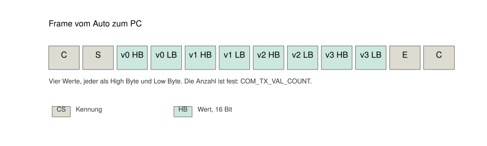
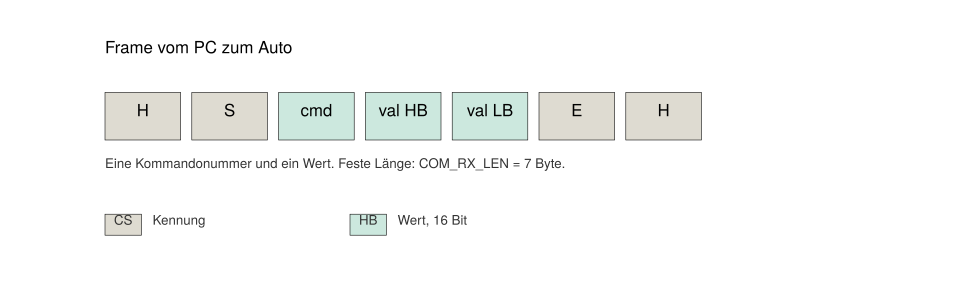

[⬅ Zurück zur Aufgabenstellung](README.md)

# Kommunikation mit dem Fahrzeug

## Inhalt
- [Warum ein Frame nötig ist](#warum-ein-frame-nötig-ist)
- [Wer die Vereinbarung besitzt](#wer-die-vereinbarung-besitzt)
- [Die beiden Frameformate](#die-beiden-frameformate)
- [Ein Zahlenwert, zwei Bytes](#ein-zahlenwert-zwei-bytes)
- [Negative Zahlen](#negative-zahlen)
- [USB oder Bluetooth: die Umschaltung](#usb-oder-bluetooth-die-umschaltung)
- [Der zweite UART](#der-zweite-uart)
- [Die Gegenstelle am PC](#die-gegenstelle-am-pc)

---

## Warum ein Frame nötig ist

In Einheit 5 haben Sie Zeichenfolgen über den UART geschickt und in HTerm angesehen. Das reicht für einen Funktionsnachweis, nicht für Telemetrie. Ein UART überträgt einen **Strom von Bytes ohne Anfang und Ende** – der Empfänger weiß nicht, wo ein Datensatz beginnt, und bei einem verlorenen Byte verschiebt sich alles Folgende dauerhaft.

Dass daraus Frames werden, ist allein eine **Vereinbarung** – und wer sie besitzt, gibt sie nach unten weiter. Dieser Satz trägt alles Weitere in dieser Einheit.

Die Lösung ist ein **Frame**: eine feste Struktur mit erkennbarem Anfang, bekannter Länge und erkennbarem Ende. Der Empfangsteil in `halUSCIA0` sucht bereits nach einem Sync-Muster – jetzt bekommt dieses Muster einen Inhalt.

---

## Wer die Vereinbarung besitzt

Die Vereinbarung gehört `driverCom`: Startmuster, Framelänge, Bedeutung der Felder, Baudrate. Der HAL kennt nichts davon – er führt aus, was ihm beim Start gesagt wurde. Sichtbar wird das an der vorgegebenen Initialisierung:

```c
void driverComInit(void)
{
    halComInit(COM_BAUDRATE);
    halComStart(comSyncHost, 2, COM_RX_LEN);
}
```

<p align="center">
  
</p>

Alle vier Eingänge rechts stammen aus `driverCom.h` und `driverCom.c` – keiner aus dem HAL:

| Eingang | Bedeutung | steht in |
|---|---|---|
| `COM_BAUDRATE` | 57600 über USB | `driverCom.h` |
| `comSyncHost` | das Startmuster `'H'`, `'S'` | `driverCom.c`, global und `const` |
| `2` | Länge dieses Musters | Aufruf in `driverComInit()` |
| `COM_RX_LEN` | Gesamtlänge des Kommandoframes | `driverCom.h` |

Welches der beiden UART-Module dabei angesprochen wird, steht nicht in dieser Funktion: `halComInit` und `halComStart` sind Makros aus `driverCom.h`. Der Treiber erbt das Modul aus seinem eigenen Header und muss es nicht kennen – dasselbe Prinzip wie bei `halComSend()`.

**Deshalb steht die UART-Initialisierung ab dieser Einheit im Treiber und nicht mehr in `halInit()`.** Die Baudrate ist Teil der Vereinbarung. Bliebe der Aufruf in `halInit()`, stünde sie an zwei Stellen – oder `halGeneral.c` müsste `driverCom.h` einbinden, der HAL also einen Header des Driver Layer. Beides widerspricht der Aufrufrichtung im Bild: Aufrufe gehen nach unten, Eingänge kommen von oben. In Einheit 5 war die Initialisierung in `halInit()` richtig, weil es über dem UART noch keinen Treiber gab.

### Was `halComStart()` tut

Kein Vorgang, sondern eine Übergabe:

<p align="center">
  
</p>

Vier Dinge passieren, und jedes hat eine Folge:

- **Die Form wird gemerkt, nicht kopiert.** `uartSync` erhält den *Zeiger* auf `comSyncHost`. Die Empfangs-ISR liest dort bei jedem einzelnen Byte nach – deshalb ist das Array global und `const` und darf keine lokale Variable sein.
- **Der Zustand wird zurückgesetzt.** Ein halb empfangener Frame aus einem früheren Durchlauf würde sonst weitergeführt.
- **Ein altes Zeichen wird verworfen.** Zwischen `halComInit()` und `halComStart()` kann bereits ein Byte eingetroffen sein; es gehört zu keinem Frame.
- **Freigegeben wird zuletzt.** Die Interrupts sind global schon frei, weil `halInit()` vor `driverInit()` läuft. Das erste Byte kann unmittelbar nach dieser Zeile eintreffen – dann muss der Zustand darüber bereits stimmen.

Beim Senden übergeben Sie die Daten, beim Empfangen einmal vorher die Form:

| | Senden | Empfangen |
|---|---|---|
| anstoßen | `halComSend(data, len)` – jedes Mal | `halComStart(sync, syncLen, frameLen)` – einmal beim Init |
| Arbeit | die ISR schiebt Bytes hinaus | die ISR sammelt Bytes ein |
| Ergebnis | `halComTxBusy()` fragt nach | `halComGetFrame()` entnimmt |

Beachten Sie das Wort in der letzten Zelle: `halComGetFrame()` liest nicht, sie **entnimmt**. Nach dem Aufruf ist der Frame aus dem Puffer verschwunden, ein zweiter Aufruf liefert 0. Jeder Frame kommt genau einmal bei Ihnen an – was Sie nicht auspacken, ist weg.

---

## Die beiden Frameformate

Beide Richtungen haben ein eigenes Format, und beide sind absichtlich unterschiedlich gekennzeichnet:

**Vom Fahrzeug zum PC** – Telemetrie, feste Länge:

<p align="center">
  
</p>

**Vom PC zum Fahrzeug** – ein Kommando mit einem Wert, feste Länge:

<p align="center">
  
</p>

Beide Frames haben eine **feste Länge**: 12 Byte zum PC, 7 Byte zurück. Diese Länge steht aber **nicht im Frame**. Was in beiden Bildern nicht vorkommt, ist so wichtig wie das, was drinsteht: keine Längenangabe, keine Prüfsumme, kein Feld, das den Inhalt beschreibt. Der Frame trägt eine Kennung, die Nutzbytes und wieder eine Kennung – mehr nicht.

Die Länge ist also **Vereinbarung**, nicht Ansage. Wie viele Werte kommen, in welcher Reihenfolge sie stehen und was sie bedeuten, wissen beide Seiten aus ihrem eigenen Code: im Fahrzeug als `COM_TX_VAL_COUNT` in `driverCom.h`, am PC als `NUM_VALS` beziehungsweise `NAMEN` in der Gegenstelle.

Das ist keine Sparsamkeit, sondern eine Entscheidung. Ein selbstbeschreibender Frame müsste auf beiden Seiten ausgewertet werden, und ein Empfänger, der auf eine angekündigte Länge wartet, bleibt stehen, wenn die Ankündigung verlorengeht. Hier gibt es nichts, worauf man vergeblich warten könnte: Kommt Unsinn, setzt der Empfang beim nächsten Sync-Muster wieder auf.

Die feste Länge nimmt Ihnen in dieser Einheit eine ganze Fehlerklasse ab: Es gibt keinen Frame, der mal kürzer und mal länger ist, und damit nichts, was aus dem Tritt geraten kann. Dafür zahlen Sie einen Preis, und den sollten Sie kennen: **Ändern Sie die Anzahl der Werte im Fahrzeug, müssen Sie sie auch in der Gegenstelle ändern.** Dieselbe Festlegung steht an zwei Stellen. Vergisst man eine davon, verwirft der PC stillschweigend jeden Frame – ein Fehlerbild, das aussieht, als wäre die Leitung tot.

> **Das Format ist ein Vorschlag, keine Vorschrift.** In dieser Einheit halten sich alle an dieses Frameformat, damit die mitgelieferten Gegenstellen passen und die Fehlersuche vergleichbar bleibt. Sobald die Übertragung in beide Richtungen nachweislich läuft, können Sie es ändern: mehr Werte, andere Reihenfolge, zusätzliche Felder, eine Prüfsumme, mehrere Frametypen. Die Übertragung gehört Ihrem Team – Sie müssen nur beide Seiten gleichzeitig anpassen und begründen können, warum Ihr Format tut, was es tut.

`C` steht für Car, `H` für Host. Dass die beiden Richtungen verschiedene Kennungen haben, ist kein Schmuck: Hängt versehentlich eine Schleife zwischen TX und RX, oder lauscht ein Gerät auf der falschen Leitung, fällt es sofort auf, statt plausibel aussehenden Unsinn zu erzeugen.

> **Warum das Frameende prüfen, wenn der Anfang doch schon erkannt wurde?** Weil das Sync-Muster auch mitten in den Nutzdaten auftauchen kann. Ein Sensorwert von **18515** wird als die beiden Bytes 72 und 83 übertragen – und das sind genau die ASCII-Codes von `'H'` und `'S'`. Der Empfänger hält diese zwei Datenbytes für einen Frameanfang und beginnt an der falschen Stelle. Erst die Prüfung des Frameendes deckt das auf: Dort steht dann kein `'E'`, `'H'`, und der Frame wird verworfen statt falsch ausgewertet.

---

## Ein Zahlenwert, zwei Bytes

Ein `unsigned int` ist auf dem MSP430 16 Bit breit, ein UART überträgt 8 Bit. Jeder Wert wird deshalb in zwei Bytes zerlegt, und **beide Seiten müssen sich über die Reihenfolge einig sein**:

```c
frame[n++] = value >> 8;        // high byte zuerst
frame[n++] = value & 0xFF;      // dann low byte
```

Die Gegenstelle setzt entsprechend zusammen:

```matlab
vals = double(payload(1:2:end)) * 256 + double(payload(2:2:end));
```

Diese Festlegung heißt **Big Endian** und ist bei Übertragungsprotokollen die übliche. Der MSP430 legt Zahlen im Speicher andersherum ab – würde man den Speicherinhalt einfach so hinausschicken, kämen die Bytes vertauscht an. Deshalb zerlegt der Code die Zahl ausdrücklich, statt sich auf die Speicherlage zu verlassen.

Was dabei schiefgehen kann, sieht man am besten an echten Zahlen. Nehmen Sie den vorgegebenen Testsatz:

| gesendet | richtig zusammengesetzt | bei vertauschten Bytes |
|---|---|---|
| 0 | 0 | 0 |
| 4095 | 4095 | **65295** |
| 65535 | 65535 | 65535 |
| −40 | −40 | **55551** |

Zwei der vier Werte sind unauffällig: Bei 0 und 65535 sind beide Bytes gleich, da fällt eine Vertauschung nicht auf. Bei 4095 und −40 schon, und zwar sofort und ohne Rechnerei. Genau deshalb stehen diese vier Zahlen im Testsatz.

---

## Negative Zahlen

Der Frame überträgt **keine Vorzeichen**. Er überträgt 16 Bit, mehr nicht. Ob diese 16 Bit eine Zahl von 0 bis 65535 bedeuten oder eine von −32768 bis +32767, steht nirgends im Frame – das entscheidet erst, wer die Zahl ausliest.

Auf der Fahrzeugseite heißt das: Sie schicken den Wert einfach als `unsigned int` weg, auch wenn er negativ gemeint ist. Das Bitmuster bleibt dasselbe:

```c
signed int lenkwinkel = -40;
werte[0] = (unsigned int)lenkwinkel;    // dasselbe Bitmuster, jetzt als 65496 gelesen
```

Auf der PC-Seite wird es wieder eingerenkt. Die Regel ist eine Zeile: **Alles über 32767 ist in Wirklichkeit negativ**, und man zieht 65536 ab.

```matlab
if wert > 32767
    wert = wert - 65536;        % 65496 -> -40
end
```

Im MATLAB-Skript steht dafür die Variable `SIGNED`: ein Eintrag je Wert, `1` bedeutet „diesen als vorzeichenbehaftet lesen". Beim Testsatz ist das nur der letzte.

Das ist keine Notlösung, sondern genau das, was jedes Protokoll tut. Die Bedeutung von Bits steht in der Vereinbarung zwischen den beiden Seiten, nicht in den Bits selbst. Dieselbe Frage stellt sich in Einheit 7 noch einmal beim VL53L1X, dort in der Gegenrichtung.

---

## USB oder Bluetooth: die Umschaltung

Das Fahrzeug hat zwei UARTs: den Debug-UART über den Debugger und den AUX-UART auf der Steckerleiste, an den sich ein Funkmodul stecken lässt. Beide sollen **dasselbe** Protokoll sprechen, und der Treiber soll nicht wissen, über welchen er gerade redet.

> Ob zum Zeitpunkt Ihrer Übung ein Funkmodul am Fahrzeug steckt, sagt Ihnen die Betreuung. Für den Nachweis der Umschaltung brauchen Sie keines: Dass der Frame danach auf der **anderen Leitung** und mit **anderem Bittiming** erscheint, sehen Sie am Analog Discovery.

Gelöst ist das mit einem Satz Makros, der zur Übersetzungszeit umgelegt wird:

```c
#define COM_USE_BT  0       // 0 = USB (UCA0), 1 = Bluetooth (UCA1)

#if COM_USE_BT
    #define COM_BAUDRATE   9600
    #define halComInit     halUSCIA1Init
    #define halComSend     halUSCIA1Send
    …
#else
    #define COM_BAUDRATE   57600
    #define halComInit     halUSCIA0Init
    #define halComSend     halUSCIA0Send
    …
#endif
```

`driverCom.c` ruft nur noch `halComInit()`, `halComSend()`, `halComGetFrame()` auf. **Ein einziges `#define` legt den Weg fest**, und keine Zeile des Treibers ändert sich dabei.

Drei Dinge folgen daraus:

**Es kostet zur Laufzeit nichts.** Der Präprozessor ersetzt die Namen, im übersetzten Code steht direkt die richtige Funktion – keine Abfrage, kein Funktionszeiger.

**Es ist keine Laufzeitumschaltung.** Welcher Weg gilt, entscheidet sich beim Übersetzen. Um zu wechseln, muss neu gebaut und geflasht werden. Für dieses Fahrzeug ist das richtig so: Beim Fahren hängt kein USB-Kabel dran, in der Werkstatt kein Bluetooth-Modul.

**Beide können nicht gleichzeitig laufen.** Die beiden UART-Module teilen sich ihren Empfangs- und Sendezustand in `halSharedUART.h` – das ist die Datei, die Ihnen in Einheit 5 schon begegnet ist und deren Zweck jetzt sichtbar wird. Ein Empfangspuffer statt zweier, zugunsten des Speichers.

---

## Der zweite UART

`halUSCIA1` bekommen Sie fertig. Es ist dasselbe Modul wie `halUSCIA0` aus Einheit 5, mit drei Unterschieden:

| | `halUSCIA0` | `halUSCIA1` |
|---|---|---|
| Anschluss | eZ-FET des Debuggers, virtueller COM-Port | Steckerleiste, Bluetooth-Modul |
| Pins | P2.0 / P2.1, über Port-Mapping | P8.2 / P8.3, feste Pinfunktion |
| Baudrate im Projekt | 57600 | 9600 |

Die niedrigere Baudrate am Bluetooth ist kein Zufall: Viele Module laufen ab Werk mit 9600, und die Luftstrecke verträgt weniger als ein Kabel.

Der Unterschied bei den Pins ist der Grund, warum für diesen UART **kein Port-Mapping** nötig ist: P8.2 und P8.3 tragen die UCA1-Funktion fest, dort genügt das `PxSEL`-Bit. Das Schlüsselregister `PMAPKEYID` aus Einheit 5 brauchen Sie hier nicht.

> **Vergleichen Sie die beiden Empfangszweige Zeile für Zeile.** Sie sind fast identisch – an einer Stelle aber nicht. Spielen Sie beide Varianten von Hand durch: Sync-Muster `'H','S'`, eintreffender Zeichenstrom `H H S …`. Welche der beiden erkennt den Frame, welche nicht, und woran liegt es? Das ist genau der Fall aus dem Kasten oben, diesmal im Code.

---

## Die Gegenstelle am PC

Zum Fahrzeug gehören zwei Gegenstellen. Beide sprechen dasselbe Protokoll, sie sind für verschiedene Arbeitsschritte gedacht.

**Zum Lesen: [`tools/crazyCarCom.m`](tools/crazyCarCom.m)**

Ein kurzes MATLAB-Skript. Es öffnet den seriellen Port, synchronisiert auf `'C','S'`, prüft das Frameende, setzt die Werte zusammen und zeichnet sie auf. Absichtlich kurz und absichtlich ohne Oberfläche: **Sie sollen die Gegenseite Ihres eigenen Protokolls lesen können.** Dieselbe Festlegung steht dort in MATLAB, die Sie in C getroffen haben – wenn eine der beiden Seiten nicht stimmt, sehen Sie an welcher Stelle. Fangen Sie damit an.

```matlab
PORT      = "COM7";        % Gerätemanager -> MSP Application UART
BAUD      = 57600;         % 57600 über USB, 9600 über Bluetooth
NUM_VALS  = 4;             % muss zu COM_TX_VAL_COUNT passen
```

Drei Zeilen sind anzupassen, und alle drei müssen zu Ihrem Fahrzeug passen. Stimmt `NUM_VALS` nicht, läuft die Synchronisation aus dem Tritt und das Skript verwirft jeden Frame – ein guter Testfall für Ihre eigene Fehlerprüfung.

**Zum Arbeiten: [`tools/ccMonitor.py`](tools/ccMonitor.py)**

Eine kleine Oberfläche in Python. Links läuft mit, was das Fahrzeug sendet; rechts schicken Sie Kommandoframes hin, ohne jedes Mal ein Skript zu ändern. Beide Richtungen zeigt sie zusätzlich in Hex an:

```
43 53 | FF D8  00 32 | 45 43
```

Damit sehen Sie Ihren Frame so, wie er auf der Leitung steht – dieselbe Ansicht wie später im UART-Dekoder des Analog Discovery, nur ohne Messgerät. Das macht sie zum nützlichsten Werkzeug bei der Fehlersuche: Steht links ein Frame, der anders aussieht als gedacht, liegt der Fehler in `driverComSend()`. Steht gar keiner, liegt er davor.

Angepasst wird auch hier nur der Block am Dateianfang:

```python
PORT  = "COM7"                       # Geraetemanager -> MSP Application UART
BAUD  = 57600                        # 57600 ueber USB, 9600 ueber Bluetooth
NAMEN = ["Wert 0", "Wert 1", ...]    # so viele Werte schickt Ihr driverComSend()
VORZEICHEN = [0, 0, 0, 1]            # 1 = diesen Wert als vorzeichenbehaftet lesen
TYPEN = {1: ("Lenkwinkel", -100, 100),
         2: ("Gas",        -100, 100)}   # Ihre Kommandotabelle
```

`TYPEN` ist Ihre Kommandotabelle aus der Aufgabenstellung, noch einmal – je Eintrag erscheint rechts eine Zeile mit Schieberegler und Knopf. Für eine Nummer, die es im Fahrzeug noch gar nicht gibt, gibt es unten eine freie Zeile: Typ und Wert eintippen, senden, am Fahrzeug im Debugger nachsehen. So lässt sich ein Kommando ausprobieren, bevor es im C-Code existiert.

Zwei Dinge sind zu beachten. `pyserial` und `matplotlib` müssen installiert sein (`pip install pyserial matplotlib`), und **nur ein Programm kann den Port öffnen** – MATLAB, HTerm und der Monitor vertragen sich nicht gleichzeitig.

Ohne Fahrzeug lässt sich die Oberfläche mit `python ccMonitor.py --demo` ansehen, und `python ccMonitor.py --selftest` prüft Packen und Auspacken gegen genau den Testsatz, der weiter oben in der Tabelle steht – ohne Port, ohne Fenster.

In beiden Werkzeugen steht dieselbe Vereinbarung wie in Ihrem C-Code, und in beiden steht sie an genau einer Stelle. Das ist der praktische Teil dessen, was im Abschnitt über die Frameformate steht: Was nicht im Frame steht, muss gepflegt werden.

---

[⬆ Zurück zur Aufgabenstellung](README.md)
