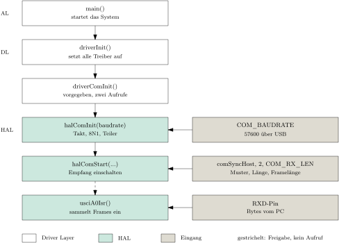
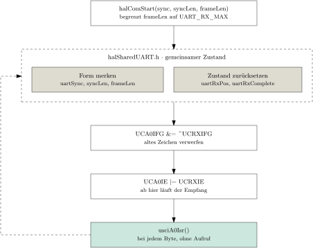
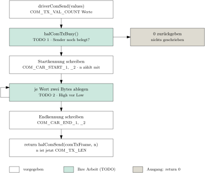
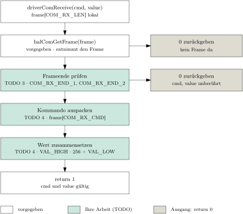

[⬅ Zurück zur Kapitelübersicht](../README.md#einheitsübersicht--aufgabenstellungen)
# Display und Kommunikation

## Inhalt
- [Die Unterkapitel](#die-unterkapitel)
- [Der Treiber kennt sein Modul nicht](#der-treiber-kennt-sein-modul-nicht)
- [Steuerleitungen des Displays](#steuerleitungen-des-displays)
- [USCIB1 für den Displaytreiber abändern](#uscib1-für-den-displaytreiber-abändern)
- [Displaytreiber vervollständigen](#displaytreiber-vervollständigen)
- [Kommunikation in Betrieb nehmen](#kommunikation-in-betrieb-nehmen)
- [Verifikation mit dem Analog Discovery](#verifikation-mit-dem-analog-discovery)
- [Testing](#testing)

**Zu erreichende Ziele**

Am Ende dieser Einheit zeigt das Fahrzeug eigene Werte auf dem Display an und tauscht
Daten mit dem PC aus – über USB, mit einem eigenen Frameformat in beide Richtungen.

- [ ] Umstrukturierung von `halUSCIB1Transmit() .h/.c` 
- [ ] A0- und Reset-Leitung sind in `halGPIOInit()` als Ausgänge konfiguriert und über `halSetLCDCmd()`, `halSetLCDData()` und `halSetLCDReset()` schaltbar.
- [ ] `driverLCD.c` ist vervollständigt: Text und Zahlen ausgeben.
- [ ] Text läuft am Zeilenende in die nächste Seite um und bricht am Displayende ab.
- [ ] Die UART-Initialisierung steht in `driverComInit()` und nicht mehr in `halInit()`.
- [ ] `driverCom.c` ist vervollständigt: Telemetrieframe packen, empfangenen Frame auspacken und auf das Frameende prüfen.
- [ ] `driverLCDInit()` und `driverComInit()` werden aus `driverInit()` aufgerufen; die Hauptschleife empfängt, zeigt an und sendet.
- [ ] Der vorgegebene Testsatz kommt am PC unverfälscht an, **einschließlich** `4095` und `-40`.
- [ ] Die Gegenstelle am PC zeigt eigene Messwerte; ein Frame vom PC wird empfangen, geprüft und am Fahrzeug sichtbar gemacht.
- [ ] Telemetrieframes und empfangene Frames sind am Analog Discovery dekodiert; an der A0-Leitung ist erkennbar, welche SPI-Bytes Befehle und welche Bilddaten sind.

**Tests:** DL-Tests – erstmals ohne Hardware, weil Packen und Auspacken reine Logik sind; die Fälle aus den Einheiten 2 bis 5 bestehen weiterhin.

**Laborübung**

- [ST7565 Dot Matrix LCD Controller Datasheet](https://www.hpinfotech.ro/ST7565.pdf)
  - Seite 13: [MPU-Interface](https://www.hpinfotech.ro/ST7565.pdf#page=13)
  - Seite 15: [Display Data RAM](https://www.hpinfotech.ro/ST7565.pdf#page=15)
  - Seiten 32–41: [Befehlstabelle](https://www.hpinfotech.ro/ST7565.pdf#page=32)
- Crazy Car Controller FHJ Schaltplan [Crazy Car Schematic](https://fhjoanneum-my.sharepoint.com/:b:/g/personal/florian_mayer_fh-joanneum_at/EfXYu-rqsLRErJbybsbN4AEB_RUMizJhwpb5D_ysimZehA?e=Ti7PtO)
- Digilent **Analog Discovery** mit **WaveForms** – [Referenzhandbuch](https://digilent.com/reference/test-and-measurement/analog-discovery-3/reference-manual)
- Gegenstelle am PC: MATLAB oder Python 3 mit `pyserial` und `matplotlib` (`pip install pyserial matplotlib`)

**Wissensüberprüfung**

- Recherche:
  - Wie ist der Bildspeicher eines ST7565 organisiert, und warum braucht die Spaltenadresse zwei Befehlsbytes?
  - Wozu dient die A0-Leitung, und warum genügt SPI allein nicht?
  - Warum braucht ein Datenstrom über UART einen Frame, ein SPI-Transfer aber nicht?
  - Was bedeutet Big Endian, und warum legt man das bei einem Protokoll fest?
- Arbeiten Sie die beiden Unterkapitel durch – siehe unten.

> **VORSICHT:** Bleibt das Programm beim ersten Displayzugriff stehen, setzt Ihr `halUSCIB1Init()` aus Einheit 5 das Statusbit `TxSuc` nicht auf 1. Nach einem Reset steht es auf 0, und `driverLCDSend()` wartet auf ein Ende, das nie kommt.

**Video**
 - [Einführungsvideo - Einheit 6](https://youtu.be/4Aope99ldoM)

### Durchzuführende Aufgaben
- [[AUFGABE] A0- und Reset-Leitung setzen](#aufgabe-a0--und-reset-leitung-setzen)
- [[AUFGABE] Modifikation halUSCB1](#aufgabe-modifikation-haluscb1)
- [[AUFGABE] driverLCD – Text und Zahlen ausgeben](#aufgabe-driverlcd--text-und-zahlen-ausgeben)
- [[AUFGABE] driverComInit – Kommunikation starten](#aufgabe-drivercominit--kommunikation-starten)
- [[AUFGABE] driverComSend – Frame packen](#aufgabe-drivercomsend--frame-packen)
- [[AUFGABE] driverComReceive – Frame auspacken](#aufgabe-drivercomreceive--frame-auspacken)
- [[AUFGABE] Senden und Empfangen in main()](#aufgabe-senden-und-empfangen-in-main)
- [[AUFGABE] Messen am Analog Discovery](#aufgabe-messen-am-analog-discovery)

---

In dieser Einheit bekommen die Schnittstellen aus Einheit 5 ihre Gegenstelle. Was am Messgerät ein Rechteckmuster war, wird zu Text auf einer Anzeige; was in HTerm eine Zeichenfolge war, wird zu einem Protokoll mit Frames und einem Plot am PC.

| Komponente | Modul | Verwendung | Ihre Aufgabe |
|---|---|---|---|
| Steuerleitungen | `halGPIO` | A0 und Reset des Displays | selbst ergänzen |
| Display | `driverLCD` | Anzeige am Fahrzeug | drei Funktionen selbst schreiben |
| Kommunikation | `driverCom` | Telemetrie und Frames vom PC | zwei Funktionen selbst schreiben |

Beide Treiber werden am Ende mit dem Analog Discovery gemessen und dekodiert – diesmal nicht als Funktionsnachweis einer Schnittstelle, sondern als Prüfung Ihres eigenen Protokolls.

---

## Die Unterkapitel

Die Grundlagen stehen in zwei eigenen Unterkapiteln. Das erste behandelt den Displaycontroller, das zweite das Protokoll; beide enden mit einer Übersicht, was vorgegeben ist und was nicht.

| | Inhalt |
|---|---|
| ➡ **[Das Display am SPI](Display.md)** | Seiten und Spalten, A0-Leitung, Initialisierungssequenz, Fonttabelle, Fehlerbilder |
| ➡ **[Kommunikation mit dem Fahrzeug](Kommunikation.md)** | Frameformat, Big Endian, Gegenstelle am PC |

Arbeiten Sie das jeweilige Unterkapitel vor der zugehörigen Aufgabe durch. Die Aufgabenstellungen unten setzen voraus, dass Sie den Bildspeicheraufbau und das Frameformat kennen – sie wiederholen die Grundlagen nicht.

---

## Der Treiber kennt sein Modul nicht

Einheit 5 hat eine Regel aufgestellt: Registerzugriffe gehören in den HAL. Diese Einheit stellt die zweite daneben – **ein Treiber darf nicht einmal wissen, welches HAL-Modul unter ihm arbeitet.**

Sichtbar wird das an der Kommunikation. `driverCom.c` ruft nie `halUSCIA0Send()` oder `halUSCIA1Send()` auf, sondern immer nur `halComSend()`. Diesen Namen gibt es als Funktion gar nicht – er wird vom Präprozessor ersetzt, und zwar je nach einem einzigen Schalter in `driverCom.h`:

```c
#define COM_USE_BT  0                       // 0 = USB (UCA0), 1 = Bluetooth (UCA1)

#if COM_USE_BT
    #define halComSend   halUSCIA1Send      // ab hier bedeutet halComSend: UCA1
#else
    #define halComSend   halUSCIA0Send      // ab hier bedeutet halComSend: UCA0
#endif
```

Beim Übersetzen wird aus jedem `halComSend()` im Treiber die eine oder die andere Funktion. In dieser Einheit bleibt der Schalter auf `0`: alles läuft über USB. Dass ein Wechsel später **keine Zeile** in `driverCom.c` kostet, ist der Punkt – der zweite UART ist nicht Teil dieser Einheit. Dasselbe Prinzip beim Display: `driverLCD.c` kennt `driverLCDWriteData()` und `halSetLCDData()`, aber kein einziges USCI-Register.

Daraus ergibt sich, wo in dieser Einheit was entsteht: halUSCIB1.c

| Schicht | Datei | was dazukommt |
|---|---|---|
| **HAL** | `halGPIO.c/.h` | A0- und Reset-Leitung, drei Schaltfunktionen |
| **HAL** | `halUSCIB1.c/.h` | `halUSCIB1Transmit()` abändern, sowie `halUSCIB1Busy()`einführen |
| **DL** | `driverLCD.c` | `WriteText`, `WriteUInt` |
| **DL** | `driverCom.c` | `driverComSend()`, `driverComReceive()` |
| **AL** | `main.c` | Hauptschleife: empfangen, anzeigen, senden |

Die beiden Treiber werden in `driverInit()` gestartet, nach `halInit()` – `driverLCDInit()` braucht sowohl das SPI-Modul als auch die beiden GPIO-Leitungen:

```c
void driverInit(void)
{
    driverSetSteering(0);
    // driverESCinit();
    driverLCDInit();        // << neu
    driverComInit();        // << neu
}
```

**Beispielhaft:** Die Hauptschleife könnte aus 3 aufeinanderfolgenden Testschritten bestehen. Wichtig ist das man nach dieser Einheit das Display sowie die Kommunikation via USB schon mal verwenden kann. 
**Info vorweg**, beides ist während dem Fahren recht umständlich. 

```c
unsigned char cmd = 0;          // zuletzt empfangene Kommandonummer
unsigned int  val = 0;          // zuletzt empfangener Wert
unsigned int  tele[COM_TX_VAL_COUNT];   // die Werte, die ans PC gehen

while (1)
{
    /* 1. empfangen */
    if (driverComReceive(&cmd, &val))
    {
        // was mit cmd und val geschieht, entscheiden Sie
    }

    /* 2. anzeigen – Seite 2, Spalte 0 */
    driverLCDWriteUInt(val, 2, 0);

    /* 3. senden */
    tele[0] = 0;                // hier einen eigenen Wert eintragen
    /* ... bis tele[COM_TX_VAL_COUNT-1] */
    driverComSend(tele);

    delayMsBlocked(100);        // rund zehn Frames je Sekunde
}
```

Die Wartezeit am Ende ist nötig. Ohne sie durchläuft die Schleife tausende Male pro Sekunde: `driverComSend()` liefert dann meistens `0` zurück, weil der vorige Frame noch unterwegs ist, und das Display wird ununterbrochen neu beschrieben, obwohl sich nichts geändert hat. Kaputt geht dabei nichts – die CPU dreht nur leer.

**Was in `tele[]` steht, entscheiden Sie.** Für den ersten Funktionsnachweis genügen Zählwerte oder der vorgegebene Testsatz. Sobald der läuft, tragen Sie dort einen Wert ein, den Ihr Fahrzeug tatsächlich kennt – die Drehzahlmessung aus Einheit 4 ist der naheliegende Kandidat, weil sie schon Zahlen liefert, die sich beim Drehen des Rads sichtbar ändern. Dazu kommen der zuletzt gestellte Lenkwert und das zuletzt empfangene Kommando. Sensoren gibt es in dieser Einheit noch keine; die kommen in Einheit 7 dazu und reihen sich dann in dasselbe Array ein.

Die Anzahl der Werte ist **fest**: `COM_TX_VAL_COUNT` in `driverCom.h`. Damit hat jeder Telemetrieframe immer dieselbe Länge, und Sie müssen sich in dieser Einheit nicht um wechselnde Framelängen kümmern. Wer die Anzahl später ändert, ändert auch `NUM_VALS` beziehungsweise `NAMEN` am PC – sonst verwirft die Gegenstelle stillschweigend jeden Frame.

**Zwei Arten, das Senden auszulösen.** Die Schleife oben sendet zyklisch – richtig für Messwerte, die sich dauernd ändern. Manches will man aber nur dann schicken, wenn es passiert ist: ein Startsignal, ein Zustandswechsel, ein Knopfdruck. Dafür nehmen Sie den Taster aus Einheit 2 und senden nur in dessen Flanke:

```c
if (tasterFlanke)               // Ihr Flag aus Einheit 2
{
    tasterFlanke = 0;
    tele[0] = ;                 // was auch immer Sie melden wollen
    driverComSend(tele);
}
```

Beides zugleich geht auch. Der Frame bleibt dabei derselbe – gleiche Länge, gleiche Reihenfolge; was Sie in einem Fall nicht belegen, setzen Sie auf einen festen Wert. Der Empfänger könnte die beiden Anlässe ohnehin nicht auseinanderhalten, weil im Frame nicht steht, was drin ist.

> **In den Serviceroutinen schreiben Sie nichts.** Die Empfangs-ISR des UART sammelt den Frame selbsttätig ein, sobald `driverComInit()` ihr über `halComStart()` Sync-Muster und Framelänge mitgeteilt und den Empfangsinterrupt freigegeben hat; die SPI-ISR schiebt die Displaybytes nach. Ihr Code fragt nur ab und stößt an.

---

## Steuerleitungen des Displays

Das Display hängt am SPI, aber zwei seiner Leitungen gehören nicht dazu. Beide sind gewöhnliche GPIO-Ausgänge, und beide hat bisher niemand eingerichtet:

| Leitung | Aufgabe | wann geschaltet |
|---|---|---|
| **A0** (im Datenblatt auch D/C) | unterscheidet Befehl von Bilddaten | **vor** jedem Senden |
| **Reset** | Hardware-Reset des Controllers | einmal beim Start |

In Einheit 5 haben Sie das Chip Select auf demselben Weg angelegt. Das vorgegebene `driverLCD.c` ruft die drei Schaltfunktionen bereits auf – ohne sie lässt es sich nicht übersetzen. Deshalb steht diese Aufgabe am Anfang.

### [AUFGABE] A0- und Reset-Leitung setzen

1. **Pins ermitteln** und das Ergebnis in die Tabelle aus Einheit 5 nachtragen:

   | Signal | Pin | Sonderfunktion über | Richtung |
   |---|---|---|---|
   | LCD A0 (Data/Command) | | gewöhnlicher I/O | Ausgang |
   | LCD Reset | | gewöhnlicher I/O | Ausgang |

2. **In `halGPIO.h` benennen**, nach dem Muster der Makros aus Einheit 2:

   ```c
   #define LCD_DATACMD     BITx        // A0  – Befehl oder Bilddaten
   #define LCD_RESET_PIN   BITx        // Hardware-Reset des Controllers
   ```

3. **In `halGPIOInit()` als Ausgang konfigurieren.** Beide brauchen ein gesetztes `PxDIR`-Bit und **kein** `PxSEL` – es sind einfache Ausgänge, keine Sonderfunktion.

4. **Drei Funktionen in `halGPIO.c` schreiben.** Die Prototypen kommen nach `halGPIO.h`, der Rumpf sieht so aus – ersetzen Sie die TODOs durch je eine Zeile:

   ```c
   /* Auszug aus halGPIO.c – Steuerleitungen des Displays */

   void halSetLCDCmd(void)                  // A0 = 0: die folgenden Bytes sind Befehle
   {
       // TODO: A0-Pin auf 0 ziehen
   }

   void halSetLCDData(void)                 // A0 = 1: die folgenden Bytes sind Bildpunkte
   {
       // TODO: A0-Pin auf 1 setzen
   }

   void halSetLCDReset(bool lcdResetOn)
   {
       // TODO: lcdResetOn == true  -> Reset aktiv
       //       lcdResetOn == false -> Reset geloest
       //
       //       Vorsicht: die Leitung ist aktiv LOW. "Reset aktiv" heisst
       //       Pegel 0, nicht 1.
   }
   ```

   Für `bool` muss `<stdbool.h>` in `halGPIO.h` eingebunden sein.

   > **Achtung:** Die Reset-Leitung ist **aktiv LOW**. `halSetLCDReset(true)` muss den Pin auf 0 ziehen, nicht auf 1. Gehen Sie nach dem Schaltplan, nicht nach dem Funktionsnamen.

5. **Prüfen Sie das Ergebnis im Debugger**, bevor Sie weitermachen: Nach `halGPIOInit()` müssen beide Bits in `PxDIR` stehen. Rufen Sie `halSetLCDData()` und `halSetLCDCmd()` nacheinander auf und beobachten Sie das Bit in `PxOUT`. Ein falsch gewählter Pin erzeugt später ein Fehlerbild, das wie ein Fehler im Displaytreiber aussieht – und dort suchen Sie dann vergeblich.

6. **[Meilensteinüberprüfung]** Warum gehören diese beiden Leitungen in den HAL und nicht in `driverLCD.c`, obwohl sie ausschließlich vom Display gebraucht werden?

---

## USCIB1 für den Displaytreiber abändern

In Einheit 5 stand das SPI-Modul für sich. Nachgewiesen wurde, was auf der Leitung
ankommt; wer die Bytes vorher in den Sendepuffer gelegt hat, war für die Messung
gleichgültig. Deshalb genügte `halUSCIB1Transmit()` ohne Parameter – der Aufrufer
füllte `TxData` selbst:

```c
LCD_Data.TxData.Data[0] = 0xA5;     // so ging das in Einheit 5
LCD_Data.TxData.len = 1;
halUSCIB1Transmit();
```
**Den Rumpf umbauen.** Was bisher vermutlich vor der Funktion getan wurde, soll jetzt die Funktion mit den Übergabewerten machen:

   ```c
   /* halUSCIB1.c – Geruest. Ersetzen Sie jedes TODO durch Code. */

   void halUSCIB1Transmit(unsigned char *data, unsigned char len)
   {
       unsigned char i;

       // TODO 1: nichts zu senden? -> zurueck, ohne etwas anzufassen.

       // TODO 2: die uebergebenen Bytes in den Sendepuffer der Struktur
       //         kopieren.

       // TODO 3: len und cnt in der Struktur setzen, Fertig-Status
       //         zuruecknehmen.

       // TODO 4: Chip Select aktivieren und das erste Byte in UCB1TXBUF
       //         schreiben. Den Rest schiebt die ISR nach - die bleibt
       //         unveraendert.
   }
   ```
Falls noch nicht vorhanden: eine Funktion, die den Fertig-Status kapselt `halUSCIB1Busy()`. Ab hier ist sie der einzige Weg, von außen zu erfahren, ob das Modul frei ist.

   ```c
   unsigned char halUSCIB1Busy(void)
   {
      return (LCD_Data.Status.B.TxSuc == 0);   // 0 = frei, 1 = Übertragung läuft
   }
   ```

### [AUFGABE] Modifikation halUSCB1

1. **Modifizieren** Sie `halUSCIB1Transmit` um das Übertragen einzelner Bytes im Driver Layer **loszutreten**  

2. **Anlegen** (wenn noch nicht vorhanden) von `halUSCIB1Busy()`

## Displaytreiber vervollständigen

Der Controller kennt keine Zeichen, keine Zahlen und keine Zeilen – er kennt Bytes im Bildspeicher. Alles andere macht Ihr Treiber.

Vorgegeben ist, was im Datenblatt steht oder reine Mechanik ist: der Weg eines Bytes zum Display, die Initialisierungssequenz, die Aufteilung der Spaltenadresse, das Löschen und die Fonttabelle.

```c
void driverLCDWriteCommand(const unsigned char *data, unsigned char dataLength);  // A0 = 0
void driverLCDWriteData   (const unsigned char *data, unsigned char dataLength);  // A0 = 1
void driverLCDSetPosition (unsigned char page, unsigned char col);                // Cursor setzen
void driverLCDClear       (void);                                                 // alle Seiten leeren
```

Die ersten beiden warten intern auf das Ende der vorigen SPI-Übertragung, schalten A0 um und stoßen `halUSCIB1Transmit()` aus Einheit 5 an; das Chip Select wird dort gesetzt, nicht hier.

> Bildspeicher, A0-Leitung und Fonttabelle: ➡ **[Das Display am SPI](Display.md)**

### [AUFGABE] driverLCD – Text und Zahlen ausgeben

1. **Dateien ins Projekt übernehmen:** `driverFonttable.h`, `driverLCD.h` und `driverLCD.c` nach `DL/`.

2. **Erster Funktionsnachweis.** Tragen Sie `driverLCDInit()` in `driverInit()` ein und starten Sie das Programm. Die Anzeige muss danach **leer** sein statt zufällig gefüllt – `driverLCDInit()` ruft das vorgegebene `driverLCDClear()` bereits auf.

   Bleibt sie zufällig gefüllt oder hängt das Programm, liegt es nicht an Ihrem Treiber, sondern an den Steuerleitungen oder am SPI aus Einheit 5. Sehen Sie in die [Fehlerbilder](Display.md#fehlerbilder), bevor Sie weitermachen.

3. **`driverLCDWriteText()` schreiben** – TODO 1.
   - Cursor einmal auf `(page, col)` setzen, dann je Zeichen die sechs Spalten aus `font_table[]` als Bilddaten senden
   - Die Zeichenbreite steht als `fonts_width_max` im Fontheader
   - Nach jedem Zeichen `col` um diese Breite erhöhen. Das Display zählt zwar selbst weiter, aber **Ihre** Funktion muss wissen, wo sie steht – sonst merkt sie nicht, wann die Zeile zu Ende ist

   Drei Fälle sind abzufangen:

   | Fall | Reaktion |
   |---|---|
   | Zeichen passt nicht mehr in die Zeile | nächste Seite, Spalte 0, Cursor neu setzen |
   | letzte Seite ist voll | abbrechen |
   | Zeichen nicht in der Tabelle | Ersatzzeichen, z. B. `'?'` |

   `char` ist auf dem MSP430 vorzeichenbehaftet – ein Zeichen über 127 ergibt sonst einen negativen Index.

4. **`driverLCDWriteUInt()` schreiben** – TODO 2.
   - `number % DEZIMAL + '0'` liefert die **letzte** Ziffer als ASCII-Zeichen, `number /= DEZIMAL` rückt eine Stelle weiter
   - Die Ziffern fallen also von rechts nach links an, ausgegeben werden müssen sie von links nach rechts: Füllen Sie einen Puffer von hinten nach vorne
   - Für die Puffergröße ist `MAX_DIGIT` aus `driverLCD.h` gedacht; ein `unsigned int` wird höchstens 65535, also fünf Stellen
   - Ausgeben über `driverLCDWriteText()`, nicht über eine eigene Zeichenschleife
   - **Achtung bei `number == 0`:** Eine `while`-Schleife, die vor dem ersten Durchlauf prüft, läuft hier kein einziges Mal, und es wird gar nichts ausgegeben. Entweder `do … while` verwenden oder die Null gesondert behandeln

5. **Startbildschirm ausgeben:** Teamname und eine Zahl, an einer Position Ihrer Wahl. Damit ist der Treiber abgenommen.

6. **[Meilensteinüberprüfung]** Sie schreiben 128 Bytes in eine Seite, ohne die Position dazwischen neu zu setzen. Warum funktioniert das, und was passiert beim 129. Byte?

7. **[Meilensteinüberprüfung]** Warum ist `font_table` als `[128][6]` angelegt und nicht als `[6][128]`? Was würde die andere Reihenfolge beim Senden kosten?

---

## Kommunikation in Betrieb nehmen

Ein UART überträgt einen Strom von Bytes ohne Anfang und Ende. Damit daraus Telemetrie wird, braucht es einen Frame – und auf beiden Seiten dieselbe Festlegung, in welcher Reihenfolge die Bytes eines 16-Bit-Werts gehen.

Das sind die beiden Frames-Vorschläge, auf die die momentanen Beispiele in dieser Einheit aufbauen, diese sind individuell abänderbar:

<p align="center">
  
</p>
<p align="center">
  
</p>

Warum der Frame weder eine Länge noch eine Prüfsumme trägt und was das für Ihre Gegenstelle bedeutet, steht im [Unterkapitel](Kommunikation.md#die-beiden-frameformate).

Vorgegeben sind der Header mit den Framelängen, die Initialisierung und die Gegenstelle am PC. Ihre Arbeit sind die beiden Funktionen, die den Frame packen und auspacken. Dafür stehen vier Funktionen des HAL bereit:

```c
void          halComStart(const unsigned char *sync, unsigned char syncLen, unsigned char frameLen);
unsigned char halComSend(const unsigned char *data, unsigned char length);  // 1 = übernommen, 0 = Sender belegt
unsigned char halComTxBusy(void);                                           // 1 = sendet gerade, 0 = frei
unsigned char halComGetFrame(unsigned char *dest);                          // >0 = Frame kopiert, 0 = keiner da
```

Die folgenden vier Aufgaben bauen aufeinander auf: zuerst die Kommunikation starten, dann senden, dann empfangen, dann beides in der Hauptschleife zusammenführen.

> Frameformat, Byte-Reihenfolge und Gegenstelle: ➡ **[Kommunikation mit dem Fahrzeug](Kommunikation.md)**

---

### [AUFGABE] driverComInit – Kommunikation starten

Diese Funktion ist vorgegeben. Sie zu lesen lohnt trotzdem, denn sie ist die einzige Stelle, an der Ihr Protokoll in den HAL hineinwandert – alles Spätere baut darauf auf.

```c
void driverComInit(void)
{
    halComInit(COM_BAUDRATE);
    halComStart(comSyncHost, 2, COM_RX_LEN);
}
```

<p align="center">
  
</p>

Zwei Aufrufe, zwei verschiedene Dinge.

**`halComInit(COM_BAUDRATE)` richtet das Modul ein:** Taktquelle, 8 Datenbits, keine Parität, ein Stoppbit, und den Teiler, der aus `SMCLK_FREQU` und der Baudrate folgt. Danach ist der UART betriebsbereit – **der Empfang ist aber noch aus**. Das ist kein Versehen: die Interrupts sind zu diesem Zeitpunkt global bereits freigegeben, weil `halInit()` vor `driverInit()` läuft. Würde der Empfang schon hier anspringen, liefe die ISR los, bevor ihr jemand gesagt hat, wonach sie suchen soll.

**`halComStart(...)` schaltet ihn ein.** Die Funktion überträgt nichts. Sie übergibt dem HAL die **Form** des erwarteten Frames und gibt den Empfangsinterrupt frei:

<p align="center">
  
</p>

Ihre drei Eingänge kommen alle aus dem Driver Layer – der HAL rechnet nichts davon aus, er bekommt es gesagt:

| Eingang | Bedeutung | steht in |
|---|---|---|
| `comSyncHost` | das Startmuster `'H'`, `'S'`, nach dem die ISR sucht | `driverCom.c`, global und `const` |
| `2` | Länge dieses Musters | Aufruf in `driverComInit()` |
| `COM_RX_LEN` | Gesamtlänge des erwarteten Frames | `driverCom.h` |

Was die Funktion damit tut, sind vier Schritte, und die Reihenfolge ist keine Geschmackssache:

1. **Die Form merken.** Musterzeiger, Musterlänge und Framelänge wandern in die gemeinsamen Variablen aus `halSharedUART.h`. Gemerkt wird der **Zeiger**, nicht der Inhalt – die ISR liest bei jedem einzelnen Byte dort nach. Deshalb ist `comSyncHost` global und `const`; eine lokale Variable wäre nach dem Verlassen der Funktion ungültig, und die ISR vergliche gegen Speichermüll.
2. **Den Empfangszustand zurücksetzen.** Position und Fertigkennzeichen auf null, damit kein halb empfangener Frame aus einem früheren Durchlauf weitergeführt wird.
3. **Ein altes Zeichen verwerfen.** Zwischen den beiden Aufrufen kann bereits ein Byte eingetroffen sein; es steht im Empfangsregister und gehört zu keinem Frame.
4. **`UCRXIE` setzen.** Erst jetzt, als letzte Zeile. Ab hier sammelt die ISR selbstständig Frames ein, so lange das Fahrzeug läuft – **ohne dass Ihr Programm dafür jemals etwas aufruft.** Es gibt im ganzen Projekt keine Funktion, die einen Frame abholt und darauf wartet; eine solche Funktion würde Ihre Regelung anhalten.

Welches der beiden UART-Module dabei angesprochen wird, steht nicht in `driverComInit()`. `halComInit` und `halComStart` sind Makros aus `driverCom.h` und werden beim Übersetzen durch `halUSCIA0…` ersetzt. Der Treiber erbt das Modul aus seinem eigenen Header und muss es nicht kennen – dasselbe Prinzip wie bei `halComSend()`.

**Durchzuführen:**

1. **Dateien ins Projekt übernehmen:** `driverCom.h` und `driverCom.c` nach `DL/`.

2. **`driverComInit()` in `driverInit()` aufrufen.**

3. **Die UART-Initialisierung aus `halInit()` entfernen.** In Einheit 5 stand sie dort, und das war richtig, solange es über dem UART keinen Treiber gab. Jetzt gibt es ihn, und er bringt seine Baudrate selbst mit: `COM_BAUDRATE` steht in `driverCom.h`. Bliebe der Aufruf in `halInit()`, stünde die Baudrate an zwei Stellen – oder `halGeneral.c` müsste `driverCom.h` einbinden, also der HAL einen Header des Driver Layer. Beides widerspricht der Richtung im ersten Bild: Aufrufe gehen nach unten, Eingänge kommen von oben.

4. **Im Debugger prüfen**, bevor Sie weitermachen:

   | Prüfung | erwartet |
   |---|---|
   | `UCA0IE` nach `driverComInit()` | `UCRXIE` gesetzt |
   | `uartFrameLen` | `COM_RX_LEN` |
   | `uartSync[0]`, `uartSync[1]` | `'H'`, `'S'` |

   Stimmt das, läuft der Empfang bereits – ohne eine einzige Zeile Ihres Codes.

5. **[Meilensteinüberprüfung]** Was passiert, wenn `comSyncHost` als lokale Variable in `driverComInit()` angelegt wird? Begründen Sie mit dem, was `halComStart()` sich merkt.

6. **[Meilensteinüberprüfung]** `halComStart()` setzt `UCRXIE` als letzte Zeile, nachdem der Zustand steht. Was ginge schief, wenn diese Zeile an den Anfang der Funktion rückt?

---

### [AUFGABE] driverComSend – Frame packen

Grau ist Ihre Arbeit, weiß ist vorgegeben, der Ausgang nach rechts ist ein `return 0`. Die TODO-Nummern stehen so in `driverCom.c`:

<p align="center">
  
</p>

Die Funktion bekommt ein Array mit `COM_TX_VAL_COUNT` Werten. Die Framelänge ist fest – wie viele Werte ein Frame trägt, steht als `#define` in `driverCom.h` und nicht im Frame selbst. Sie baut den Frame in `comTxFrame[]` und übergibt ihn an `halComSend()` – gesendet wird danach von der ISR, Byte für Byte, während Ihr Programm weiterläuft.

> **Achtung:** `halComSend()` merkt sich nur die **Adresse** Ihres Puffers, nicht dessen Inhalt. Wer `comTxFrame` beschreibt, während noch gesendet wird, verschickt eine Mischung aus altem und neuem Frame. Deshalb steht `halComTxBusy()` an erster Stelle.

**Durchzuführen:**

1. **TODO 1 – Sender prüfen.** Läuft noch eine Übertragung, nichts tun und `0` zurückgeben.

2. **TODO 2 – je Wert zwei Bytes.** Die Schleife läuft `COM_TX_VAL_COUNT` mal, höherwertiges Byte zuerst, `n` dabei mitzählen. `n` ist am Ende die Framelänge für `halComSend()` und muss `COM_TX_LEN` ergeben. Start- und Endkennung sind bereits vorgegeben.

3. **Mit dem Testsatz prüfen.** Bevor Sie eigene Messwerte verschicken:

   ```c
   driverComSend(comTestVals);
   ```

   Der Testsatz hat genau `COM_TX_VAL_COUNT` Werte – er füllt einen vollständigen Frame.

   Am PC müssen danach genau diese vier Zahlen stehen:

   | | erwartet | falls die Bytereihenfolge vertauscht ist |
   |---|---|---|
   | Wert 0 | `0` | 0 – fällt nicht auf |
   | Wert 1 | `4095` | **65295** |
   | Wert 2 | `65535` | 65535 – fällt nicht auf |
   | Wert 3 | `-40` | **55551** |

   Stimmen `4095` und `-40`, stimmt Ihre Zerlegung.

4. **Gegenstelle starten.** `crazyCarCom.m` liegt **außerhalb** des CCS-Projekts – legen Sie es ab, wo MATLAB es findet. Anzupassen sind `PORT` und `BAUD`; `NUM_VALS` und `SIGNED` stehen bereits auf dem Testsatz. `NUM_VALS` muss zu `COM_TX_VAL_COUNT` passen, sonst verwirft das Skript stillschweigend jeden Frame.

   Den COM-Port finden Sie im Gerätemanager unter *MSP Application UART*. Lassen Sie HTerm dabei geschlossen – zwei Programme können denselben Port nicht gleichzeitig öffnen. Dieselbe Gegenstelle mit Oberfläche und Hex-Ansicht ist [`tools/ccMonitor.py`](tools/ccMonitor.py): ➡ **[Die Gegenstelle am PC](Kommunikation.md#die-gegenstelle-am-pc)**

5. **Eigene Werte senden.** Erst jetzt den Testsatz durch echte Größen ersetzen. Die Drehzahlmessung aus Einheit 4 eignet sich am besten: Drehen Sie ein Rad von Hand, und die Kurve am PC muss sich bewegen. Das ist zugleich die erste Messung, bei der Sie die gesamte Kette sehen – Geber, ISR, Treiber, Frame, Leitung, Gegenstelle.

   **Was in den vier Werten steht, entscheiden Sie** – die Anzahl ist fest. Reicht sie Ihnen später nicht, ändern Sie `COM_TX_VAL_COUNT` **und** die Gegenstelle am PC; variable Längen pro Frame braucht es dafür nicht.

6. **[Meilensteinüberprüfung]** Was passiert, wenn ein Sensorwert zufällig die Bytes `'E'` und `'C'` enthält? Beschreiben Sie das Fehlerbild und einen Weg, es zu vermeiden.

7. **[Meilensteinüberprüfung]** Warum liegt `comTxFrame` global in `driverCom.c` und nicht als lokale Variable in `driverComSend()`?

---

### [AUFGABE] driverComReceive – Frame auspacken

Derselbe Aufbau spiegelbildlich: der HAL-Aufruf steht vorn statt hinten, geprüft wird hinterher statt vorher.

<p align="center">
  
</p>

`halComGetFrame()` liest nicht, sie **entnimmt**: nach dem Aufruf ist der Frame aus dem Puffer verschwunden, ein zweiter Aufruf liefert `0`. Jeder Frame kommt genau einmal bei Ihnen an.

**Durchzuführen:**

1. **TODO 3 – Frameende prüfen.** `frame[COM_RX_END_1]` und `frame[COM_RX_END_2]` müssen `COM_HOST_END_1` und `COM_HOST_END_2` sein. Passt es nicht: `0` zurückgeben und `*cmd` und `*value` **nicht** anfassen – der Aufrufer behält dann seinen letzten gültigen Wert.

   Auf den Frameanfang müssen Sie nicht prüfen, darauf hat der HAL bereits synchronisiert. Warum die Prüfung des Endes trotzdem nötig ist, steht im [Unterkapitel](Kommunikation.md#die-beiden-frameformate).

2. **TODO 4 – auspacken.** Kommandonummer und 16-Bit-Wert über die `COM_RX_…`-Indizes, in derselben Byte-Reihenfolge wie beim Senden.

3. **Mit HTerm prüfen.** Port öffnen, Sendefeld auf Hex stellen und einen Frame schicken, zum Beispiel `48 53 01 00 64 45 48`. Im Debugger muss `driverComReceive()` eine `1` liefern, `cmd` eine `1` und `value` eine `100` enthalten.

4. **Gegenprobe mit falschem Frameende**, etwa `48 53 01 00 64 45 41`. Die Funktion muss `0` liefern, und `cmd` und `value` dürfen sich nicht ändern.

5. **[Meilensteinüberprüfung]** Warum dürfen `*cmd` und `*value` bei einem ungültigen Frame nicht verändert werden? Was hätte der Aufrufer sonst in der Hand?

6. **[Meilensteinüberprüfung]** `driverComReceive()` benutzt ein lokales `frame[COM_RX_LEN]`, `driverComSend()` einen globalen Puffer. Warum ist das nicht symmetrisch?

---

### [AUFGABE] Senden und Empfangen in main()

Beide Richtungen laufen unabhängig voneinander – UART ist vollduplex, Senden behindert den Empfang nicht. In der Hauptschleife stehen sie deshalb einfach nebeneinander:

```c
while (1)
{
    /* zyklisch abfragen: ist ein Frame da? */
    if (driverComReceive(&cmd, &val))
    {
        /* Ihre Entscheidung, was damit geschieht */
    }

    /* zyklisch senden */
    driverComSend(tele);

    delayMsBlocked(100);        // rund zehn Frames je Sekunde
}
```

`driverComReceive()` kostet nichts, wenn nichts da ist – sie liefert dann sofort `0`. Das Abfragen in jedem Durchlauf ist also kein Aufwand, sondern der Normalfall.

**Durchzuführen:**

1. **Senden zyklisch einbauen**, mit den Werten aus der vorigen Aufgabe. Die Wartezeit nicht vergessen: ohne sie durchläuft die Schleife tausende Male je Sekunde, `driverComSend()` liefert dann meistens `0`, weil der vorige Frame noch unterwegs ist.

2. **Empfang in jedem Durchlauf abfragen.**

3. **Sichtbar machen, dass ein Frame angekommen ist** – auf dem Display, über eine LED oder im Debugger. Wie, entscheiden Sie.

4. **Was mit einem empfangenen Frame geschieht, legen Sie fest.** Naheliegend ist, damit zur Laufzeit einen Parameter zu verstellen, statt ihn im Code zu ändern und neu zu flashen – für das Einstellen von Reglerwerten beim Training ist das später der eigentliche Nutzen dieser Schnittstelle. Welche Nummer welchen Parameter meint, ist Sache Ihres Teams; halten Sie es schriftlich fest, die Gegenstelle braucht dieselbe Tabelle.

5. **[Meilensteinüberprüfung]** Ein 16-Bit-Feld ist vorzeichenlos. Wie übertragen Sie einen negativen Wert, und an welcher Stelle Ihrer Schichten wird daraus wieder eine negative Zahl?

6. **[Meilensteinüberprüfung]** Senden und Empfangen stehen in derselben Schleife, ohne einander zu stören. Woran liegt das – welche Teile des UART sind dafür getrennt?

**Wenn Zeit bleibt:**

- **Ein Balken statt einer Zahl.** Einen Wert als Balken über eine Displayseite: Jedes Byte ist eine Spalte, `0xFF` ist voll, `0x18` ein dünner Strich in der Mitte. Dafür braucht es keine Fonttabelle, nur `driverLCDWriteData()`.
- **Senden auf Knopfdruck.** Statt zyklisch nur dann einen Frame schicken, wenn der Taster aus Einheit 2 gedrückt wurde – und am PC nachsehen, dass genau ein Frame ankommt, nicht zehn. Wer das sauber hinbekommt, hat die Entprellung von damals richtig gelöst.

---

## Verifikation mit dem Analog Discovery

In Einheit 5 haben Sie nachgewiesen, dass die Schnittstellen korrekte Bytes erzeugen. Jetzt prüfen Sie Ihr **eigenes Protokoll**: ob auf der Leitung genau der Frame steht, den Ihr Code bauen wollte.

> Anschluss, Pinbelegung und Dekoder-Einstellungen stehen im Unterkapitel von Einheit 5:
> ➡ **[Messen mit dem Analog Discovery](../Kapitel_05_Schnittstellen/AnalogDiscovery.md)**
>
> Die Schritte unten sagen, *was* zu messen ist; die kursiven Zeilen nennen, **wo** die Einstellung in WaveForms liegt.

### [AUFGABE] Messen am Analog Discovery

**Telemetrie über USB**

1. Kanal auf die TX-Leitung von UCA0 legen, UART-Dekoder auf 57600 Baud, 8N1. Zeichnen Sie **einen** Telemetrieframe auf. Im Mitschnitt müssen `'C'`, `'S'`, Ihre Werte und `'E'`, `'C'` als Bytes erkennbar sein.

   *In WaveForms:* **Logic** → **+ (Add)** → *Protocol* → **UART**. Trigger auf die **fallende Flanke** der TX-Leitung, dann **Single** – ein stehendes Bild lässt sich vermessen.

2. Vergleichen Sie die Bytefolge mit dem, was die Gegenstelle anzeigt. Am schnellsten geht das mit der Hex-Zeile in `ccMonitor.py`: Dort steht derselbe Frame, den der Dekoder zeigt – einmal von der Software gelesen, einmal von der Leitung abgenommen. Weichen die beiden voneinander ab, ist das der interessanteste Befund dieser Einheit.

**Frame in der Gegenrichtung**

3. Betreiben Sie das Analog Discovery unter *Protocol → UART* und schicken Sie einen Kommandoframe an das Fahrzeug: `'H'`, `'S'`, Kommandonummer, zwei Wertbytes, `'E'`, `'H'`. Prüfen Sie im Debugger, dass `driverComReceive()` eine 1 liefert und die richtigen Werte ausgibt.

   *In WaveForms:* Logic-Fenster schließen. **Protocol** → Reiter **UART** → **Send & Receive**, Baudrate 57600.

4. Schicken Sie anschließend einen Frame mit **falschem Frameende**. `driverComReceive()` muss eine 0 liefern und Kommando und Wert unverändert lassen.

**Befehl oder Bilddaten am Display**

5. Legen Sie Kanäle auf CLK, MOSI, CS und zusätzlich auf die **A0-Leitung**. SPI-Dekoder wie in Einheit 5 einstellen und einen Displayzugriff aufzeichnen.

   Im Bild müssen die drei Kommandobytes des Cursors und die darauffolgenden Bilddaten unterscheidbar sein – allein am Pegel der A0-Leitung. Damit ist gezeigt, dass Ihre Schaltfunktionen aus der ersten Aufgabe zum richtigen Zeitpunkt umschalten.

**Zu dokumentieren**

6. Je ein Screenshot: Telemetrieframe über USB, Frame in der Gegenrichtung, Displayzugriff mit A0-Leitung.
7. **[Meilensteinüberprüfung]** Im Mitschnitt stehen zwei Bytes je Wert. Woran erkennen Sie, welches das höherwertige ist – ohne in Ihren Code zu sehen?
8. **[Meilensteinüberprüfung]** Rechnen Sie nach: Wie viele Bytes hat Ihr Frame bei `NUM_VALS` Werten, und wie lange dauert seine Übertragung bei 57600 Baud?

---

## Testing

In dieser Einheit lassen sich die Treiber erstmals ohne Hardware prüfen:

➡ **[Testing – Display und Kommunikation](Testing/Testing.md)**

## Referenzen

- **ST7565 65 × 132 Dot Matrix LCD Controller**, Sitronix, Version 1.0a.  
  Verfügbar unter: [https://www.hpinfotech.ro/ST7565.pdf](https://www.hpinfotech.ro/ST7565.pdf)

- **MSP430x5xx and MSP430x6xx Family User Guide**, Texas Instruments, Literature Number: SLAU208O, Rev. O, April 2019.  
  Verfügbar unter: [https://www.ti.com/lit/pdf/slau208](https://www.ti.com/lit/pdf/slau208)

- **MSP430F5335 Datasheet**, Texas Instruments, Document Number: SLAS590N, Rev. N, October 2018.  
  Verfügbar unter: [https://www.ti.com/lit/gpn/msp430f5335](https://www.ti.com/lit/gpn/msp430f5335)

[⬆ Zurück zum Hauptverzeichnis](../README.md#einheitsübersicht--aufgabenstellungen)
