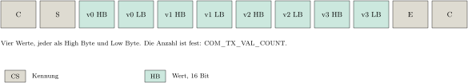
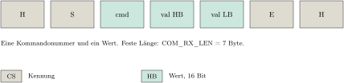

[⬅ Zurück zur Kapitelübersicht](../README.md#einheitsübersicht--aufgabenstellungen)
# Display und Kommunikation

## Inhalt
- [Die Unterkapitel](#die-unterkapitel)
- [Der Treiber kennt sein Modul nicht](#der-treiber-kennt-sein-modul-nicht)
- [Steuerleitungen des Displays](#steuerleitungen-des-displays)
- [Displaytreiber vervollständigen](#displaytreiber-vervollständigen)
- [Kommunikation in Betrieb nehmen](#kommunikation-in-betrieb-nehmen)
- [Verifikation mit dem Analog Discovery](#verifikation-mit-dem-analog-discovery)
- [Testing](#testing)

**Zu erreichende Ziele**

Am Ende dieser Einheit zeigt das Fahrzeug eigene Werte auf dem Display an und tauscht
Daten mit dem PC aus – über USB oder über Bluetooth, entschieden durch ein einziges `#define`.

- [ ] A0- und Reset-Leitung sind in `halGPIOInit()` als Ausgänge konfiguriert und über `halSetLCDCmd()`, `halSetLCDData()` und `halSetLCDReset()` schaltbar.
- [ ] `driverLCD.c` ist vervollständigt: Text und Zahlen ausgeben.
- [ ] Text läuft am Zeilenende in die nächste Seite um und bricht am Displayende ab.
- [ ] `halUSCIA1` ist eingebunden: P8.2 und P8.3 auf Sonderfunktion, Initialisierung in `halInit()`, `halSharedUART.h` weiterhin nur an einer Stelle inkludiert.
- [ ] `driverCom.c` ist vervollständigt: Telemetrierahmen packen, Kommandorahmen auspacken und auf das Rahmenende prüfen.
- [ ] `driverLCDInit()` und `driverComInit()` werden aus `driverInit()` aufgerufen; die Hauptschleife empfängt, zeigt an und sendet.
- [ ] Der vorgegebene Testsatz kommt am PC unverfälscht an, **einschließlich** `4095` und `-40`.
- [ ] Die Gegenstelle am PC zeigt eigene Messwerte; ein Kommando vom PC verändert Lenkung oder Gas.
- [ ] Die Umschaltung auf Bluetooth ist durch Ändern **einer** Zeile nachgewiesen, ohne Eingriff in `driverCom.c`.
- [ ] Telemetrierahmen und Kommandorahmen sind am Analog Discovery dekodiert; an der A0-Leitung ist erkennbar, welche SPI-Bytes Befehle und welche Bilddaten sind.

**Tests:** DL-Tests – erstmals ohne Hardware, weil Packen und Auspacken reine Logik sind; die Fälle aus den Einheiten 2 bis 5 bestehen weiterhin.

**Laborübung**

- [ST7565 Dot Matrix LCD Controller Datasheet](https://www.hpinfotech.ro/ST7565.pdf)
  - Seite 13: [MPU-Interface](https://www.hpinfotech.ro/ST7565.pdf#page=13)
  - Seite 15: [Display Data RAM](https://www.hpinfotech.ro/ST7565.pdf#page=15)
  - Seiten 32–41: [Befehlstabelle](https://www.hpinfotech.ro/ST7565.pdf#page=32)
- Crazy Car Controller FHJ Schaltplan [Crazy Car Schematic](https://fhjoanneum-my.sharepoint.com/:b:/g/personal/florian_mayer_fh-joanneum_at/EfXYu-rqsLRErJbybsbN4AEB_RUMizJhwpb5D_ysimZehA?e=Ti7PtO)
- Digilent **Analog Discovery** mit **WaveForms** – [Referenzhandbuch](https://digilent.com/reference/test-and-measurement/analog-discovery-3/reference-manual)
- Gegenstelle am PC: MATLAB oder Python 3 mit `pyserial` und `matplotlib` (`pip install pyserial matplotlib`)

**Wissensüberprüfung**

- Recherche:
  - Wie ist der Bildspeicher eines ST7565 organisiert, und warum braucht die Spaltenadresse zwei Befehlsbytes?
  - Wozu dient die A0-Leitung, und warum genügt SPI allein nicht?
  - Warum braucht ein Datenstrom über UART einen Rahmen, ein SPI-Transfer aber nicht?
  - Was bedeutet Big Endian, und warum legt man das bei einem Protokoll fest?
- Arbeiten Sie die beiden Unterkapitel durch – siehe unten.

> **VORSICHT:** Bleibt das Programm beim ersten Displayzugriff stehen, setzt Ihr `halUSCIB1Init()` aus Einheit 5 das Statusbit `TxSuc` nicht auf 1. Nach einem Reset steht es auf 0, und `lcdSend()` wartet auf ein Ende, das nie kommt.

**Video**
 - *folgt*

### Durchzuführende Aufgaben
- [[AUFGABE] A0- und Reset-Leitung setzen](#aufgabe-a0--und-reset-leitung-setzen)
- [[AUFGABE] driverLCD – Text und Zahlen ausgeben](#aufgabe-driverlcd--text-und-zahlen-ausgeben)
- [[AUFGABE] driverCom – Rahmenformat implementieren](#aufgabe-drivercom--rahmenformat-implementieren)
- [[AUFGABE] Fernsteuerung und Telemetrie](#aufgabe-fernsteuerung-und-telemetrie)
- [[AUFGABE] Messen am Analog Discovery](#aufgabe-messen-am-analog-discovery)

---

In dieser Einheit bekommen die Schnittstellen aus Einheit 5 ihre Gegenstelle. Was am Messgerät ein Rechteckmuster war, wird zu Text auf einer Anzeige; was in HTerm eine Zeichenfolge war, wird zu einem Protokoll mit Rahmen, einem Plot am PC und der Wahl zwischen Kabel und Funk.

| Komponente | Modul | Verwendung | Ihre Aufgabe |
|---|---|---|---|
| Steuerleitungen | `halGPIO` | A0 und Reset des Displays | selbst ergänzen |
| Display | `driverLCD` | Anzeige am Fahrzeug | drei Funktionen selbst schreiben |
| Kommunikation | `driverCom` | Telemetrie und Fernsteuerung | zwei Funktionen selbst schreiben |
| AUX-UART | `halUSCIA1` | Bluetooth-Modul | vorgegeben, einbinden und messen |

Beide Treiber werden am Ende mit dem Analog Discovery gemessen und dekodiert – diesmal nicht als Funktionsnachweis einer Schnittstelle, sondern als Prüfung Ihres eigenen Protokolls.

---

## Die Unterkapitel

Die Grundlagen stehen in zwei eigenen Unterkapiteln. Das erste behandelt den Displaycontroller, das zweite das Protokoll; beide enden mit einer Übersicht, was vorgegeben ist und was nicht.

| | Inhalt |
|---|---|
| ➡ **[Das Display am SPI](Display.md)** | Seiten und Spalten, A0-Leitung, Initialisierungssequenz, Fonttabelle, Fehlerbilder |
| ➡ **[Kommunikation mit dem Fahrzeug](Kommunikation.md)** | Rahmenformat, Big Endian, Umschaltung USB/Bluetooth, Gegenstelle am PC |

Arbeiten Sie das jeweilige Unterkapitel vor der zugehörigen Aufgabe durch. Die Aufgabenstellungen unten setzen voraus, dass Sie den Bildspeicheraufbau und das Rahmenformat kennen – sie wiederholen die Grundlagen nicht.

---

## Der Treiber kennt sein Modul nicht

Einheit 5 hat eine Regel aufgestellt: Registerzugriffe gehören in den HAL. Diese Einheit stellt die zweite daneben – **ein Treiber darf nicht einmal wissen, welches HAL-Modul unter ihm arbeitet.**

Sichtbar wird das an der Kommunikation. `driverCom.c` ruft nie `halUSCIA0Send()` oder `halUSCIA1Send()` auf, sondern immer nur `halComSend()`. Diesen Namen gibt es als Funktion gar nicht – er wird vom Präprozessor ersetzt, und zwar je nach einem einzigen Schalter in `driverCom.h`:

```c
#define COM_USE_BT  0                       // 0 = USB (UCA0), 1 = Bluetooth (UCA1)

#if COM_USE_BT
    #define halComSend   halUSCIA1Send      // ab hier bedeutet halComSend: UCA1
#else
    #define halComSend   halUSCIA0Send      // ab hier bedeutet halComSend: UCA0
#endif
```

Beim Übersetzen wird aus jedem `halComSend()` im Treiber die eine oder die andere Funktion. Ändern Sie die `0` in eine `1`, geht alles über Bluetooth – und **keine Zeile** in `driverCom.c` ändert sich. Dasselbe Prinzip beim Display: `driverLCD.c` kennt `driverLCDWriteData()` und `halSetLCDData()`, aber kein einziges USCI-Register.

Daraus ergibt sich, wo in dieser Einheit was entsteht:

| Schicht | Datei | was dazukommt |
|---|---|---|
| **HAL** | `halGPIO.c/.h` | A0- und Reset-Leitung, drei Schaltfunktionen |
| **HAL** | `halUSCIA1.c/.h` | der zweite UART, vorgegeben – Aufruf in `halInit()` |
| **DL** | `driverLCD.c` | `WriteText`, `WriteUInt` |
| **DL** | `driverCom.c` | `driverComSend()`, `driverComReceive()` |
| **AL** | `main.c` | Hauptschleife: empfangen, anzeigen, senden |

Die beiden Treiber werden in `driverInit()` gestartet, nach `halInit()` – `driverLCDInit()` braucht sowohl das SPI-Modul als auch die beiden GPIO-Leitungen:

```c
void driverInit(void)
{
    driverSetSteering(0);
    // driverESCinit();
    driverLCDInit();        // << neu
    driverComInit();        // << neu
}
```

Die Hauptschleife besteht aus drei Schritten, immer in derselben Reihenfolge:

```c
unsigned char cmd = 0;          // zuletzt empfangene Kommandonummer
unsigned int  val = 0;          // zuletzt empfangener Wert
unsigned int  tele[2];          // die Werte, die ans PC gehen

while (1)
{
    /* 1. empfangen */
    if (driverComReceive(&cmd, &val))
    {
        // Kommando auf Lenkung oder Gas abbilden
    }

    /* 2. anzeigen – Seite 2, Spalte 0 */
    driverLCDWriteUInt(val, 2, 0);

    /* 3. senden */
    tele[0] = 0;                // hier z. B. den Lenkwinkel eintragen
    tele[1] = 0;                // hier z. B. die Flankenzahl aus Einheit 4
    driverComSend(tele, 2);

    delayMsBlocked(100);        // rund zehn Rahmen je Sekunde
}
```

Die Wartezeit am Ende ist nötig. Ohne sie durchläuft die Schleife tausende Male pro Sekunde: `driverComSend()` liefert dann meistens `0` zurück, weil der vorige Rahmen noch unterwegs ist, und das Display wird ununterbrochen neu beschrieben, obwohl sich nichts geändert hat. Kaputt geht dabei nichts – die CPU dreht nur leer.

> **In den Serviceroutinen schreiben Sie nichts.** Die Empfangs-ISR des UART sammelt den Rahmen selbsttätig ein, sobald `driverComInit()` ihr über `halComStart()` Sync-Muster und Rahmenlänge mitgeteilt hat; die SPI-ISR schiebt die Displaybytes nach. Ihr Code fragt nur ab und stößt an.

---

## Steuerleitungen des Displays

Das Display hängt am SPI, aber zwei seiner Leitungen gehören nicht dazu. Beide sind gewöhnliche GPIO-Ausgänge, und beide hat bisher niemand eingerichtet:

| Leitung | Aufgabe | wann geschaltet |
|---|---|---|
| **A0** (im Datenblatt auch D/C) | unterscheidet Befehl von Bilddaten | **vor** jedem Senden |
| **Reset** | Hardware-Reset des Controllers | einmal beim Start |

In Einheit 5 haben Sie das Chip Select auf demselben Weg angelegt. Das vorgegebene `driverLCD.c` ruft die drei Schaltfunktionen bereits auf – ohne sie lässt es sich nicht übersetzen. Deshalb steht diese Aufgabe am Anfang.

### [AUFGABE] A0- und Reset-Leitung setzen

1. **Pins ermitteln** und das Ergebnis in die Tabelle aus Einheit 5 nachtragen:

   | Signal | Pin | Sonderfunktion über | Richtung |
   |---|---|---|---|
   | LCD A0 (Data/Command) | | gewöhnlicher I/O | Ausgang |
   | LCD Reset | | gewöhnlicher I/O | Ausgang |

2. **In `halGPIO.h` benennen**, nach dem Muster der Makros aus Einheit 2:

   ```c
   #define LCD_DATACMD     BITx        // A0  – Befehl oder Bilddaten
   #define LCD_RESET_PIN   BITx        // Hardware-Reset des Controllers
   ```

3. **In `halGPIOInit()` als Ausgang konfigurieren.** Beide brauchen ein gesetztes `PxDIR`-Bit und **kein** `PxSEL` – es sind einfache Ausgänge, keine Sonderfunktion.

4. **Drei Funktionen in `halGPIO.c` schreiben.** Die Prototypen kommen nach `halGPIO.h`, der Rumpf sieht so aus – ersetzen Sie die TODOs durch je eine Zeile:

   ```c
   /* Auszug aus halGPIO.c – Steuerleitungen des Displays */

   void halSetLCDCmd(void)                  // A0 = 0: die folgenden Bytes sind Befehle
   {
       // TODO: A0-Pin auf 0 ziehen
   }

   void halSetLCDData(void)                 // A0 = 1: die folgenden Bytes sind Bildpunkte
   {
       // TODO: A0-Pin auf 1 setzen
   }

   void halSetLCDReset(bool lcdResetOn)
   {
       // TODO: lcdResetOn == true  -> Reset aktiv
       //       lcdResetOn == false -> Reset geloest
       //
       //       Vorsicht: die Leitung ist aktiv LOW. "Reset aktiv" heisst
       //       Pegel 0, nicht 1.
   }
   ```

   Für `bool` muss `<stdbool.h>` in `halGPIO.h` eingebunden sein.

   > **Achtung:** Die Reset-Leitung ist **aktiv LOW**. `halSetLCDReset(true)` muss den Pin auf 0 ziehen, nicht auf 1. Gehen Sie nach dem Schaltplan, nicht nach dem Funktionsnamen.

5. **Prüfen Sie das Ergebnis im Debugger**, bevor Sie weitermachen: Nach `halGPIOInit()` müssen beide Bits in `PxDIR` stehen. Rufen Sie `halSetLCDData()` und `halSetLCDCmd()` nacheinander auf und beobachten Sie das Bit in `PxOUT`. Ein falsch gewählter Pin erzeugt später ein Fehlerbild, das wie ein Fehler im Displaytreiber aussieht – und dort suchen Sie dann vergeblich.

6. **[Meilensteinüberprüfung]** Warum gehören diese beiden Leitungen in den HAL und nicht in `driverLCD.c`, obwohl sie ausschließlich vom Display gebraucht werden?

---

## Displaytreiber vervollständigen

Der Controller kennt keine Zeichen, keine Zahlen und keine Zeilen – er kennt Bytes im Bildspeicher. Alles andere macht Ihr Treiber.

Vorgegeben ist, was im Datenblatt steht oder reine Mechanik ist: der Weg eines Bytes zum Display, die Initialisierungssequenz, die Aufteilung der Spaltenadresse, das Löschen und die Fonttabelle.

```c
void driverLCDWriteCommand(const unsigned char *data, unsigned char dataLength);  // A0 = 0
void driverLCDWriteData   (const unsigned char *data, unsigned char dataLength);  // A0 = 1
void driverLCDSetPosition (unsigned char page, unsigned char col);                // Cursor setzen
void driverLCDClear       (void);                                                 // alle Seiten leeren
```

Die ersten beiden warten intern auf das Ende der vorigen SPI-Übertragung, schalten A0 um und stoßen `halUSCIB1Transmit()` aus Einheit 5 an; das Chip Select wird dort gesetzt, nicht hier.

> Bildspeicher, A0-Leitung und Fonttabelle: ➡ **[Das Display am SPI](Display.md)**

### [AUFGABE] driverLCD – Text und Zahlen ausgeben

1. **Dateien ins Projekt übernehmen:** `driverFonttable.h`, `driverLCD.h` und `driverLCD.c` nach `DL/`, danach **F5**.

2. **Erster Funktionsnachweis.** Tragen Sie `driverLCDInit()` in `driverInit()` ein und starten Sie das Programm. Die Anzeige muss danach **leer** sein statt zufällig gefüllt – `driverLCDInit()` ruft das vorgegebene `driverLCDClear()` bereits auf.

   Bleibt sie zufällig gefüllt oder hängt das Programm, liegt es nicht an Ihrem Treiber, sondern an den Steuerleitungen oder am SPI aus Einheit 5. Sehen Sie in die [Fehlerbilder](Display.md#fehlerbilder), bevor Sie weitermachen.

3. **`driverLCDWriteText()` schreiben** – TODO 1.
   - Cursor einmal auf `(page, col)` setzen, dann je Zeichen die sechs Spalten aus `font_table[]` als Bilddaten senden
   - Die Zeichenbreite steht als `fonts_width_max` im Fontheader
   - Nach jedem Zeichen `col` um diese Breite erhöhen. Das Display zählt zwar selbst weiter, aber **Ihre** Funktion muss wissen, wo sie steht – sonst merkt sie nicht, wann die Zeile zu Ende ist

   Drei Fälle sind abzufangen:

   | Fall | Reaktion |
   |---|---|
   | Zeichen passt nicht mehr in die Zeile | nächste Seite, Spalte 0, Cursor neu setzen |
   | letzte Seite ist voll | abbrechen |
   | Zeichen nicht in der Tabelle | Ersatzzeichen, z. B. `'?'` |

   `char` ist auf dem MSP430 vorzeichenbehaftet – ein Zeichen über 127 ergibt sonst einen negativen Index.

4. **`driverLCDWriteUInt()` schreiben** – TODO 2.
   - `number % DEZIMAL + '0'` liefert die **letzte** Ziffer als ASCII-Zeichen, `number /= DEZIMAL` rückt eine Stelle weiter
   - Die Ziffern fallen also von rechts nach links an, ausgegeben werden müssen sie von links nach rechts: Füllen Sie einen Puffer von hinten nach vorne
   - Für die Puffergröße ist `MAX_DIGIT` aus `driverLCD.h` gedacht; ein `unsigned int` wird höchstens 65535, also fünf Stellen
   - Ausgeben über `driverLCDWriteText()`, nicht über eine eigene Zeichenschleife
   - **Achtung bei `number == 0`:** Eine `while`-Schleife, die vor dem ersten Durchlauf prüft, läuft hier kein einziges Mal, und es wird gar nichts ausgegeben. Entweder `do … while` verwenden oder die Null gesondert behandeln

5. **Startbildschirm ausgeben:** Teamname und eine Zahl, an einer Position Ihrer Wahl. Damit ist der Treiber abgenommen.

6. **[Meilensteinüberprüfung]** Sie schreiben 128 Bytes in eine Seite, ohne die Position dazwischen neu zu setzen. Warum funktioniert das, und was passiert beim 129. Byte?

7. **[Meilensteinüberprüfung]** Warum ist `font_table` als `[128][6]` angelegt und nicht als `[6][128]`? Was würde die andere Reihenfolge beim Senden kosten?

---

## Kommunikation in Betrieb nehmen

Ein UART überträgt einen Strom von Bytes ohne Anfang und Ende. Damit daraus Telemetrie wird, braucht es einen Rahmen – und auf beiden Seiten dieselbe Festlegung, in welcher Reihenfolge die Bytes eines 16-Bit-Werts gehen.

Das sind die beiden Rahmen, die Sie in dieser Einheit bauen:

<p align="center">
  
</p>

<p align="center">
  
</p>

Warum der Rahmen weder eine Länge noch eine Prüfsumme trägt und was das für Ihre Gegenstelle bedeutet, steht im [Unterkapitel](Kommunikation.md#die-beiden-rahmenformate).

Vorgegeben sind der Header mit den Rahmenlängen und der Umschaltung, die Initialisierung und die Gegenstelle am PC. Ihre Arbeit sind die beiden Funktionen, die den Rahmen packen und auspacken:

```c
unsigned char halComSend(const unsigned char *data, unsigned char length);  // 1 = übernommen, 0 = Sender belegt
unsigned char halComTxBusy(void);                                           // 1 = sendet gerade, 0 = frei
unsigned char halComGetFrame(unsigned char *dest);                          // >0 = Rahmen kopiert, 0 = keiner da
```

`halComTxBusy()` brauchen Sie gleich im ersten Schritt von `driverComSend()`: Sie müssen wissen, ob noch gesendet wird, **bevor** Sie den Puffer neu beschreiben.

> **Achtung:** `halComSend()` merkt sich nur die **Adresse** Ihres Puffers, nicht dessen Inhalt. Das Modul liest die Bytes nach und nach aus `comTxFrame` heraus, während Ihr Programm längst weiterläuft. Wer den Puffer in dieser Zeit überschreibt, verschickt eine Mischung aus altem und neuem Rahmen. Dieselbe Regel galt schon für die Module aus Einheit 5.

> Rahmenformat, Umschaltung und Gegenstelle: ➡ **[Kommunikation mit dem Fahrzeug](Kommunikation.md)**

### [AUFGABE] driverCom – Rahmenformat implementieren

1. **Dateien ins Projekt übernehmen:** `driverCom.h` und `driverCom.c` nach `DL/`, `halUSCIA1.c/.h` nach `HAL/`, danach **F5**.

2. **Den zweiten UART in Betrieb nehmen.** `halUSCIA1` ist das Gegenstück zu Ihrem Debug-UART aus Einheit 5 – gleiche Schnittstelle, andere Pins, andere Baudrate.

   - Pins P8.2 und P8.3 in `halGPIOInit()` auf die Sonderfunktion schalten. Hier genügt das `PxSEL`-Bit, die UCA1-Funktion liegt fest – es ist kein Port-Mapping nötig.
   - `halUSCIA1Init()` in `halInit()` aufrufen, mit der Baudrate aus `COM_BAUDRATE`.
   - `halSharedUART.h` bleibt weiterhin **nur an einer Stelle** inkludiert, in `halGeneral.c`. Beide UART-Module greifen auf denselben Empfangs- und Sendezustand zu; ein zweites `#include` führt zu doppelten Symbolen beim Linken.

3. **`driverComInit()` in `driverInit()` aufrufen.** Die Funktion ist vorgegeben; sehen Sie sich an, was `halComStart()` mit dem Sync-Muster macht. Ab diesem Aufruf sucht die Empfangs-ISR nach `'H'`, `'S'`.

4. **`driverComSend()` schreiben** – TODO 1 bis 4.
   - Läuft noch eine Übertragung, nichts tun und `0` zurückgeben
   - Mehr als `COM_TX_MAX_VAL` Werte auf das Maximum begrenzen
   - Rahmen in `comTxFrame[]` aufbauen: `COM_CAR_START_1`, `COM_CAR_START_2`, je Wert zwei Bytes, `COM_CAR_END_1`, `COM_CAR_END_2`
   - `n` mitzählen – es ist am Ende die Rahmenlänge für `halComSend()`

   Die Reihenfolge der beiden Bytes je Wert ist festgelegt; `crazyCarCom.m` setzt sie genau so wieder zusammen.

5. **`driverComReceive()` schreiben** – TODO 5 bis 7.
   - Rahmen mit `halComGetFrame()` abholen; liefert sie `0`, ist keiner da
   - **Rahmenende prüfen** – `frame[COM_RX_END_1]` und `frame[COM_RX_END_2]` müssen `COM_HOST_END_1` und `COM_HOST_END_2` sein
   - Bei ungültigem Rahmen `0` zurückgeben und `*cmd` und `*value` **nicht** anfassen
   - Sonst Kommando und Wert über die `COM_RX_…`-Indizes auspacken und `1` zurückgeben

   Auf den Rahmenanfang müssen Sie nicht prüfen, darauf hat der HAL bereits synchronisiert. Warum die Prüfung des Rahmenendes trotzdem nötig ist, steht im [Unterkapitel](Kommunikation.md#die-beiden-rahmenformate).

6. **Gegenstelle starten.** `crazyCarCom.m` liegt **außerhalb** des CCS-Projekts – legen Sie es irgendwo ab, wo MATLAB es findet, und öffnen Sie es dort. Anzupassen sind `PORT` und `BAUD`; `NUM_VALS` und `SIGNED` stehen bereits auf dem Testsatz. `NUM_VALS` muss immer zu Ihrem `count` passen, sonst verwirft das Skript stillschweigend jeden Rahmen.

   Den COM-Port finden Sie im Gerätemanager unter *MSP Application UART*. Lassen Sie HTerm dabei geschlossen – zwei Programme können denselben Port nicht gleichzeitig öffnen.

   Zusätzlich liegt [`tools/ccMonitor.py`](tools/ccMonitor.py) bereit: dieselbe Gegenstelle mit Oberfläche, Hex-Ansicht und einem Sendeteil für Kommandorahmen. Die brauchen Sie spätestens in der nächsten Aufgabe – und bei der Fehlersuche hier schon, weil sie den empfangenen Rahmen Byte für Byte anzeigt. Dieselben Einstellungen, derselbe Block am Dateianfang: ➡ **[Die Gegenstelle am PC](Kommunikation.md#die-gegenstelle-am-pc)**

7. **Mit dem Testsatz prüfen.** Bevor Sie eigene Messwerte verschicken, senden Sie den vorgegebenen Satz aus `driverCom.c`:

   ```c
   driverComSend(comTestVals, COM_TEST_COUNT);
   ```

   Am PC müssen danach genau diese vier Zahlen stehen:

   | | erwartet | falls die Bytereihenfolge vertauscht ist |
   |---|---|---|
   | Wert 0 | `0` | 0 – fällt nicht auf |
   | Wert 1 | `4095` | **65295** |
   | Wert 2 | `65535` | 65535 – fällt nicht auf |
   | Wert 3 | `-40` | **55551** |

   Die beiden mittleren Spalten sind das eigentliche Abnahmekriterium. Stimmen `4095` und `-40`, stimmt Ihre Zerlegung – bei `0` und `65535` sind beide Bytes gleich, da würde auch eine falsche Reihenfolge richtig aussehen.

8. **Eigene Werte senden.** Erst jetzt den Testsatz durch echte Größen ersetzen – zum Beispiel Lenkwinkel und die Flankenzahl Ihrer Drehzahlmessung aus Einheit 4.

9. **[Meilensteinüberprüfung]** Was passiert, wenn ein Sensorwert zufällig die Bytes `'E'` und `'C'` enthält? Beschreiben Sie das Fehlerbild und einen Weg, es zu vermeiden.

10. **[Meilensteinüberprüfung]** Die Umschaltung zwischen USB und Bluetooth kostet zur Laufzeit nichts. Warum, und welchen Preis zahlt man dafür?

### [AUFGABE] Fernsteuerung und Telemetrie

> **Fahrzeug aufbocken.** Die Räder müssen frei drehen können.

Natürlich ist klar, dass wir das CrazyCar grundsätzlich nicht mit dem PC fernsteuern möchten, jedoch als Test passt es sehr gut. 

1. **Kommandotabelle festlegen.** Welche Nummer was bedeutet, entscheiden Sie – aber schreiben Sie es auf, die Gegenstelle braucht dieselbe Tabelle:

   | `cmd` | Bedeutung | Wertebereich |
   |---|---|---|
   | `1` | Lenkwinkel | Ihre Festlegung |
   | `2` | Gas | Ihre Festlegung |

   Die Tabelle gilt für ein Kommando je Rahmen. Es wird **nicht** alles auf einmal geschickt: Wer die Lenkung ändert, schickt einen Rahmen mit `1`, und das Gas bleibt, was es war. Genau deshalb ist dieser Rahmen so kurz und das Senden ereignisgesteuert, während die Telemetrie in der Gegenrichtung dauernd läuft.

   In `ccMonitor.py` tragen Sie dieselbe Tabelle als `TYPEN` ein; je Eintrag erscheint eine Sendezeile mit Schieberegler.

2. **Kommandos auswerten.** Im `if`-Zweig der Hauptschleife die Kommandonummer auf `driverSetSteering()` oder `driverSetThrottle()` abbilden.

   > Das Gas reagiert nur, wenn der ESC scharfgeschaltet ist. Steht `driverESCinit()` in Ihrem `driverInit()` noch auskommentiert, bewegt sich nichts – das ist kein Fehler Ihrer Kommandoauswertung. Prüfen Sie die Lenkung zuerst, sie braucht keine Vorbereitung.

   > Der Wert kommt als `unsigned int` an, die beiden Funktionen erwarten `signed char` von −100 bis +100. Wie schickt der PC eine −50 durch ein vorzeichenloses 16-Bit-Feld? Legen Sie die Codierung fest und halten Sie sie in Ihrer Kommandotabelle fest.

3. **Vom PC senden.** Zwei Wege, beide erzeugen denselben Rahmen:

   - `ccMonitor.py` starten, Wert am Schieberegler einstellen, **Setzen**. Der gesendete Rahmen erscheint im Protokoll darunter in Hex – prüfen Sie, dass dort genau die fünf Bytes stehen, die Sie erwarten.
   - Oder im unteren Teil von `crazyCarCom.m`: Der Kommandorahmen steht dort als eigener Abschnitt, Nummer und Wert eintragen und den Abschnitt einzeln ausführen.

   Für den ersten Versuch ist der Monitor der schnellere Weg, weil Sie den Wert ändern können, ohne etwas neu auszuführen.

4. **Auf dem Display mitschreiben.** Zuletzt empfangenes Kommando und seinen Wert anzeigen. Damit sehen Sie ohne Debugger, ob das Fahrzeug verstanden hat, was gemeint war.

5. **[Meilensteinüberprüfung]** Was passiert bei einem Wert außerhalb des zulässigen Bereichs – und an welcher Stelle Ihrer Schichten gehört die Prüfung hin?

**Wenn Zeit bleibt**, zwei Erweiterungen:

- **Ein Balken statt einer Zahl.** Der Lenkwinkel als Balken über eine Displayseite: Jedes Byte ist eine Spalte, `0xFF` ist voll, `0x18` ein dünner Strich in der Mitte. Dafür braucht es keine Fonttabelle, nur `driverLCDWriteData()`.
- **Ein Nothalt.** Ein eigenes Kommando, das `driverSetThrottle(0)` auslöst, und ein Zeichen auf dem Display, solange es aktiv ist.

---

## Verifikation mit dem Analog Discovery

In Einheit 5 haben Sie nachgewiesen, dass die Schnittstellen korrekte Bytes erzeugen. Jetzt prüfen Sie Ihr **eigenes Protokoll**: ob auf der Leitung genau der Rahmen steht, den Ihr Code bauen wollte, und ob die Umschaltung auf Bluetooth tatsächlich die Leitung wechselt.

> Anschluss, Pinbelegung und Dekoder-Einstellungen stehen im Unterkapitel von Einheit 5:
> ➡ **[Messen mit dem Analog Discovery](../Kapitel_05_Schnittstellen/AnalogDiscovery.md)**
>
> Die Schritte unten sagen, *was* zu messen ist; die kursiven Zeilen nennen, **wo** die Einstellung in WaveForms liegt.

### [AUFGABE] Messen am Analog Discovery

**Telemetrie über USB**

1. Kanal auf die TX-Leitung von UCA0 legen, UART-Dekoder auf 57600 Baud, 8N1. Zeichnen Sie **einen** Telemetrierahmen auf. Im Mitschnitt müssen `'C'`, `'S'`, Ihre Werte und `'E'`, `'C'` als Bytes erkennbar sein.

   *In WaveForms:* **Logic** → **+ (Add)** → *Protocol* → **UART**. Trigger auf die **fallende Flanke** der TX-Leitung, dann **Single** – ein stehendes Bild lässt sich vermessen.

2. Vergleichen Sie die Bytefolge mit dem, was die Gegenstelle anzeigt. Am schnellsten geht das mit der Hex-Zeile in `ccMonitor.py`: Dort steht derselbe Rahmen, den der Dekoder zeigt – einmal von der Software gelesen, einmal von der Leitung abgenommen. Weichen die beiden voneinander ab, ist das der interessanteste Befund dieser Einheit.

   Rechnen Sie außerdem nach: Wie viele Bytes hat Ihr Rahmen bei `NUM_VALS` Werten, und wie lange dauert seine Übertragung bei 57600 Baud?

**Umschaltung auf Bluetooth**

3. `COM_USE_BT` in `driverCom.h` auf `1` setzen, neu bauen, flashen. **In `driverCom.c` darf sich keine Zeile ändern** – das ist der eigentliche Nachweis dieser Aufgabe.

4. Legen Sie den Kanal auf die TX-Leitung von UCA1 – P8.2 auf der Steckerleiste – und stellen Sie den Dekoder auf 9600 Baud um. Zeichnen Sie denselben Rahmen noch einmal auf.

   Messen Sie in beiden Aufzeichnungen die Dauer eines einzelnen Bits. Das Verhältnis muss zu den beiden Baudraten passen – rechnen Sie nach.

**Kommandorahmen in der Gegenrichtung**

5. Betreiben Sie das Analog Discovery unter *Protocol → UART* und schicken Sie einen Kommandorahmen an das Fahrzeug: `'H'`, `'S'`, Kommandonummer, zwei Wertbytes, `'E'`, `'H'`. Prüfen Sie im Debugger, dass `driverComReceive()` eine 1 liefert und die richtigen Werte ausgibt.

   *In WaveForms:* Logic-Fenster schließen. **Protocol** → Reiter **UART** → **Send & Receive**, Baudrate passend zur aktuellen Einstellung von `COM_USE_BT`.

6. Schicken Sie anschließend einen Rahmen mit **falschem Rahmenende**. `driverComReceive()` muss eine 0 liefern und Kommando und Wert unverändert lassen.

**Befehl oder Bilddaten am Display**

7. Legen Sie Kanäle auf CLK, MOSI, CS und zusätzlich auf die **A0-Leitung**. SPI-Dekoder wie in Einheit 5 einstellen und einen Displayzugriff aufzeichnen.

   Im Bild müssen die drei Kommandobytes des Cursors und die darauffolgenden Bilddaten unterscheidbar sein – allein am Pegel der A0-Leitung. Damit ist gezeigt, dass Ihre Schaltfunktionen aus der ersten Aufgabe zum richtigen Zeitpunkt umschalten.

**Zu dokumentieren**

8. Je ein Screenshot: Telemetrierahmen über USB, derselbe über Bluetooth, Kommandorahmen in der Gegenrichtung, Displayzugriff mit A0-Leitung.
9. **[Meilensteinüberprüfung]** Im Mitschnitt stehen zwei Bytes je Wert. Woran erkennen Sie, welches das höherwertige ist – ohne in Ihren Code zu sehen?
10. **[Meilensteinüberprüfung]** Die Umschaltung hat die Leitung gewechselt, nicht das Protokoll. Woran ist das in den beiden Aufzeichnungen zu erkennen?

---

## Testing

In dieser Einheit lassen sich die Treiber erstmals ohne Hardware prüfen:

➡ **[Testing – Display und Kommunikation](Testing/Testing.md)**

## Referenzen

- **ST7565 65 × 132 Dot Matrix LCD Controller**, Sitronix, Version 1.0a.  
  Verfügbar unter: [https://www.hpinfotech.ro/ST7565.pdf](https://www.hpinfotech.ro/ST7565.pdf)

- **MSP430x5xx and MSP430x6xx Family User Guide**, Texas Instruments, Literature Number: SLAU208O, Rev. O, April 2019.  
  Verfügbar unter: [https://www.ti.com/lit/pdf/slau208](https://www.ti.com/lit/pdf/slau208)

- **MSP430F5335 Datasheet**, Texas Instruments, Document Number: SLAS590N, Rev. N, October 2018.  
  Verfügbar unter: [https://www.ti.com/lit/gpn/msp430f5335](https://www.ti.com/lit/gpn/msp430f5335)

[⬆ Zurück zum Hauptverzeichnis](../README.md#einheitsübersicht--aufgabenstellungen)
