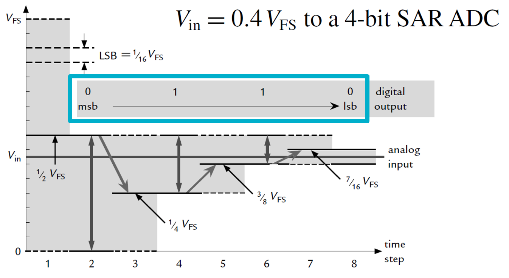
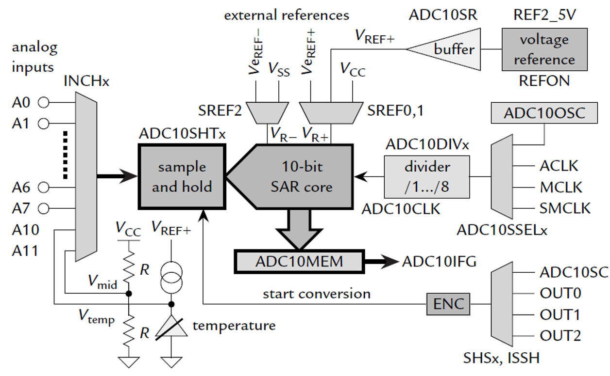

[⬅ Zurück zur Aufgabenstellung](README.md)

# ADC12_A am MSP430

## Inhalt
- [Das SAR-Prinzip](#das-sar-prinzip)
- [Sample and Hold](#sample-and-hold)
- [Referenzspannung und Auflösung](#referenzspannung-und-auflösung)
- [Sequenz statt Einzelmessung](#sequenz-statt-einzelmessung)
- [Trigger aus dem TimerB0](#trigger-aus-dem-timerb0)
- [Register](#register)
- [Die Sharp-Sensoren am Crazy Car](#die-sharp-sensoren-am-crazy-car)

**Family User Guide**
- Kapitel 28: ADC12_A *(im [Family Guide](https://e2e.ti.com/cfs-file/__key/communityserver-discussions-components-files/166/MSP430x6-Family-User-Guide.pdf) über das Inhaltsverzeichnis)*
  - 28.1 Introduction und Figure 28-1 (Blockdiagramm)
  - 28.2.7 Conversion Modes
  - 28.3 Registerbeschreibungen

---

## Das SAR-Prinzip

Der MSP430F5335 hat einen **SAR-ADC** (Successive Approximation Register). Er vergleicht die Eingangsspannung bitweise mit einer intern erzeugten Vergleichsspannung – beginnend beim höchstwertigen Bit:

```
Bit 11 setzen  →  zu groß?  →  Bit wieder löschen
Bit 10 setzen  →  zu groß?  →  Bit behalten
...
Bit 0
```

Nach zwölf Schritten steht das Ergebnis fest. Daraus folgt direkt die Wandlungsdauer: **13 ADC12CLK-Takte** pro Wandlung, unabhängig vom Messwert.

<p align="center">
  
</p>

Das ist der Grund, warum ein SAR-ADC deterministisch ist: Jede Messung dauert gleich lang. Bei einem Regelkreis zählt genau das – nicht die maximale Abtastrate, sondern dass jede Abtastung zur selben Zeit nach dem Trigger fertig ist.

---

## Sample and Hold

Vor der Wandlung muss die Eingangsspannung erst einmal festgehalten werden. Der Eingang wird über einen Multiplexer auf einen Kondensator geschaltet; dieser lädt sich über den Innenwiderstand der Quelle auf. Das ist ein RC-Glied, und es braucht Zeit.

| Phase | `SAMPCON` | Was passiert |
|---|---|---|
| **Sample** | high | Kondensator lädt sich auf die Eingangsspannung auf |
| **Hold** | low | Eingang wird getrennt, der SAR wandelt |

Die Sample-Zeit wird in `ADC12CTL0` über `ADC12SHT0x` und `ADC12SHT1x` eingestellt – in ADC12CLK-Takten, von 4 bis 1024. `ADC12SHT0x` gilt für die Speicher `ADC12MEM0` bis `7`, `ADC12SHT1x` für `8` bis `15`.

> **Zu kurz abgetastet heißt: zu klein gemessen.** Der Kondensator ist dann noch nicht fertig geladen, und das Ergebnis hängt vom vorher gemessenen Kanal ab. Der Fehler sieht aus wie ein Sensorfehler, ist aber einer der Konfiguration. Hochohmige Quellen – und ein Sharp-Sensor ist eine – brauchen eine lange Sample-Zeit.

---

## Referenzspannung und Auflösung

Der Zahlenwert sagt nichts, solange die Referenzspannung unbekannt ist. Bei 12 Bit gilt:

$$\text{Ergebnis} = 4095 \cdot \frac{V_{in}}{V_{REF}} \qquad\qquad \text{LSB} = \frac{V_{REF}}{4096}$$

Der MSP430F5335 hat ein eigenes Referenzmodul (`REFCTL0`) mit wählbarer Spannung – 1,5 V, 2,0 V oder 2,5 V. Auf dem Crazy Car wird **2,5 V** verwendet, erzeugt vom internen Referenzmodul und über `ADC12SREF_1` als `V(R+)` auf den Wandler gelegt; `V(R-)` ist AVSS.

| | Wert |
|---|---|
| Auflösung | 12 Bit, 0 … 4095 |
| Referenz | 2,5 V intern |
| LSB | 2,5 V / 4096 ≈ 0,61 mV |
| Eingangsbereich | 0 … 2,5 V |

> **Zwei Wege zur Referenz, einer davon tot.** In `ADC12CTL0` stehen ebenfalls Bits namens `ADC12REFON` und `ADC12REF2_5V`. Die stammen aus älteren MSP430-Familien und werden beim F5335 ignoriert, solange `REFMSTR` in `REFCTL0` gesetzt ist – und das ist der Reset-Zustand. Wer nur sie setzt, bekommt keine Referenz und misst Unsinn. Suchen Sie im Family User Guide nach `REFMSTR`, bevor Sie die Referenz konfigurieren.

**Eine Eingangsspannung über 2,5 V liefert 4095 und sonst nichts** – der Wert ist oben abgeschnitten, ohne Fehlermeldung. Deshalb liegt die Batteriespannung nicht direkt am Pin, sondern über einem Spannungsteiler. Dessen Faktor steckt in der Rückrechnung in `driverSensors.c`.

---

## Sequenz statt Einzelmessung

Vier Größen sollen gemessen werden, und zwar zusammengehörig. Der ADC12 kann das in einem Durchlauf, über den Modus **Sequence-of-Channels** (`ADC12CONSEQ_1`).

Dafür gibt es 16 Steuerregister `ADC12MCTL0` bis `ADC12MCTL15` und dazu 16 Ergebnisregister `ADC12MEM0` bis `ADC12MEM15`. Jedes `MCTLx` legt fest, **welcher Kanal** in `MEMx` landet und **welche Referenz** dabei gilt:

| Register | Kanal | Signal |
|---|---|---|
| `ADC12MCTL0` | A0 | `DISTANCE_RIGHT` |
| `ADC12MCTL1` | A1 | `DISTANCE_LEFT` |
| `ADC12MCTL2` | A2 | `DISTANCE_FRONT` |
| `ADC12MCTL3` | A3 | `VBAT_MEASURE`, zusätzlich `ADC12EOS` |

Das Bit **`ADC12EOS`** im letzten `MCTLx` beendet die Sequenz. Fehlt es, läuft der Wandler über alle 16 Speicher weiter und die Ergebnisse stehen an Stellen, an denen sie niemand sucht.

Zwei weitere Bits in `ADC12CTL0` gehören dazu:

- **`ADC12MSC`** (Multiple Sample and Convert): Nur die *erste* Wandlung wartet auf den Trigger, die folgenden starten selbst, sobald die vorherige fertig ist. Ohne dieses Bit bräuchte jeder Kanal einen eigenen Triggerimpuls.
- **`ADC12ENC`**: gibt den Wandler frei. Alle Konfigurationsbits dürfen nur geändert werden, solange `ADC12ENC` gelöscht ist – dasselbe Muster wie `UCSWRST` beim USCI aus Einheit 5.

---

## Trigger aus dem TimerB0

Abtastzeitpunkte, die eine Hauptschleife bestimmt, sind keine Abtastzeitpunkte – sie verschieben sich mit jedem Programmzweig. Der ADC12 wird deshalb von einem Timer gestartet.

`ADC12SHSx` in `ADC12CTL1` wählt die Quelle:

| `ADC12SHSx` | Quelle |
|---|---|
| 0 | `ADC12SC` (Softwarebit) |
| 1 | TA0 CCR1 |
| 2 | TB0 CCR0 |
| 3 | **TB0 CCR1** |

Auf dem Crazy Car ist es TB0.1. Der TimerB0 bekommt dafür einen zweiten Vergleichskanal: `TB0CCR0` legt wie gewohnt die Periode fest, `TB0CCR1` erzeugt mit `OUTMOD_7` die Flanke, die den ADC startet.

```
TB0CCR0  ────────────────────────┐  Periodendauer  →  Abtastrate
TB0CCR1  ──┐                     │
           └── OUTMOD_7 ──► ADC12SHS_3 ──► Sequenz A0,A1,A2,A3
```

Bei 120 Hz wird alle 8,3 ms eine vollständige Sequenz gemessen. Das ist schnell genug für die Regelung und langsam genug, dass die Sharp-Sensoren einen stabilen Ausgangswert liefern.

**Das ist die eigentliche Aufgabe des TimerB0.** In Einheit 3 hat er die Hintergrundbeleuchtung blinken lassen – das war die Übung am Timer, nicht sein Zweck im Fahrzeug. Ab hier gibt er den Abtasttakt vor, und damit richtet sich seine Periode nach der Abtastrate und nicht mehr nach einer Blinkfrequenz.

Daraus folgt zweierlei:

- `TB0CCR0` legt jetzt 120 Hz fest. Taktquelle, Teiler und Periode gelten für **beide** Vergleichskanäle gemeinsam – eine zweite, unabhängige Periode ist aus einem Timer nicht zu bekommen.
- Der CCR0-Interrupt aus Einheit 3 entfällt. Wer das Blinken behalten will, muss in der ISR mitzählen: Bei 120 Hz ist jeder 60. Durchlauf eine halbe Sekunde.

---

## Register

Im Blockdiagramm des Moduls lässt sich der Weg eines Messwerts von links nach rechts verfolgen: Multiplexer, Sample-and-Hold, SAR-Kern, Ergebnisspeicher – und darüber die beiden Zweige für Takt und Trigger.

<p align="center">
  
</p>

| Register | Relevante Bits | Bedeutung |
|---|---|---|
| `REFCTL0` | `REFON`, `REFVSEL_x` | internes Referenzmodul, gewählte Spannung |
| `ADC12CTL0` | `ADC12SHT0x`, `ADC12SHT1x` | Sample-Zeit in ADC12CLK-Takten |
| | `ADC12MSC` | Folgewandlungen ohne neuen Trigger |
| | `ADC12ON` | Wandler ein |
| | `ADC12ENC` | Freigabe, muss zum Konfigurieren gelöscht sein |
| `ADC12CTL1` | `ADC12SHSx` | Triggerquelle |
| | `ADC12SHP` | `SAMPCON` kommt aus dem Sampling-Timer |
| | `ADC12SSELx` | Taktquelle (SMCLK) |
| | `ADC12DIVx` | Teiler für ADC12CLK |
| | `ADC12CONSEQx` | Wandlungsmodus, `_1` = Sequence-of-Channels |
| `ADC12CTL2` | `ADC12RES_2` | 12 Bit |
| `ADC12MCTLx` | `ADC12INCHx` | Eingangskanal |
| | `ADC12SREFx` | Referenzauswahl |
| | `ADC12EOS` | letztes Element der Sequenz |
| `ADC12MEMx` | – | Ergebnis, Lesen löscht `ADC12IFG.x` |
| `ADC12IE` | `ADC12IEx` | Interruptfreigabe je Speicher |
| `ADC12IV` | – | Vektorregister mit Kennzahlen, wie `P1IV` aus Einheit 2 |

---

## Die Sharp-Sensoren am Crazy Car

Die drei Abstandssensoren sind **Sharp GP2Y0A02YK0F**. Sie arbeiten optisch nach dem Triangulationsprinzip: Eine Infrarot-LED sendet einen Strahl aus, der reflektierte Strahl trifft je nach Entfernung an einer anderen Stelle auf einen positionsempfindlichen Detektor. Herauskommt eine **analoge Spannung**.

Diese Kennlinie ist **nicht linear** und nicht einmal eindeutig: Unterhalb von etwa 20 cm fällt die Ausgangsspannung wieder ab, derselbe Spannungswert steht also für zwei verschiedene Entfernungen.

```
 U ▲
   │      ╭─╮
   │     ╱   ╲___
   │    ╱        ╲____
   │   ╱              ╲______
   └──┴────┴──────────────────────►  d
      0   20 cm                      150 cm
         Mehrdeutig!
```

Drei Eigenschaften dieser Kennlinie müssen Sie kennen, weil sie jede Auswertung bestimmen:

**Sie ist nicht linear.** Der doppelte Spannungswert bedeutet nicht die halbe Entfernung. Zwischen 20 und 40 cm ändert sich die Spannung stark, zwischen 100 und 150 cm kaum noch – die Auflösung des Sensors wird mit der Entfernung schlechter, obwohl der ADC immer dieselben 12 Bit liefert.

**Sie ist nicht eindeutig.** Unterhalb von etwa 20 cm fällt die Spannung wieder ab. Derselbe Messwert steht dann für zwei verschiedene Entfernungen – etwa für 10 cm und für 60 cm. Aus einer einzelnen Messung ist nicht entscheidbar, welche von beiden gilt. Für ein Fahrzeug ist das die unangenehmste Eigenschaft überhaupt: Ein Hindernis direkt vor der Nase sieht aus wie freie Fahrt.

**Sie ist exemplarabhängig.** Zwei Sensoren desselben Typs liefern bei gleicher Entfernung nicht genau dieselbe Spannung. Eine Umrechnung, die für einen stimmt, stimmt für den nächsten nur ungefähr.

| | Sharp GP2Y0A02 |
|---|---|
| Ausgabe | analog, 0,4 … 2,8 V |
| Messbereich | 20 … 150 cm |
| Aktualisierung | ca. 25 … 40 Hz |
| Kennlinie | nichtlinear, unterhalb 20 cm mehrdeutig, exemplarabhängig |

> **Der Ausgang reicht über 2,5 V hinaus.** Sehen Sie im Schaltplan nach, was zwischen Sensorausgang und Controllerpin liegt – und was das für Ihre Rückrechnung bedeutet.

### Was daraus folgt

Eine Umrechnung in Millimeter braucht deshalb eine **aufgemessene Tabelle** je Sensortyp, keine Formel. In dieser Einheit lesen Sie die drei Sensoren als Rohwert und beurteilen ihr Verhalten im Debugger – genau an den drei Punkten oben:

- Fahren Sie ein Hindernis langsam von 150 cm auf 20 cm heran und beobachten Sie, wie ungleichmäßig der Rohwert wächst.
- Gehen Sie weiter auf 10 cm. Der Wert fällt wieder – notieren Sie, bei welcher Entfernung er denselben Stand hat wie bei etwa 60 cm.
- Halten Sie dasselbe Hindernis in gleichem Abstand vor zwei verschiedene Sensoren und vergleichen Sie die Rohwerte.

Genau deshalb sitzen auf dem Fahrzeug zusätzlich die ToF-Sensoren: Sie liefern Millimeter ohne Kennlinie, ohne Mehrdeutigkeit und ohne Kalibrierung. Der Vergleich der beiden Verfahren – eine Spannung, die man erst deuten muss, gegen eine Zahl, die schon stimmt – ist eine der Lehren dieser Einheit.

Umgerechnet wird hier nur ein einziger Kanal: die **Batteriespannung**. Dort ist der Zusammenhang linear, der Faktor steht im Schaltplan, und das Ergebnis lässt sich mit dem Multimeter nachprüfen.

Jeder der drei Sensoren hat zusätzlich eine **Freigabeleitung**. Die drei liegen auf drei verschiedenen Ports – das ist kein Fehler, sondern eine Folge des Platinenlayouts, und es bedeutet, dass jeder Port einzeln konfiguriert werden muss. Suchen Sie die Pins im Schaltplan; es sind gewöhnliche GPIO-Ausgänge und sie gehören in `halGPIOInit()`.

---

[⬆ Zurück zur Aufgabenstellung](README.md)
