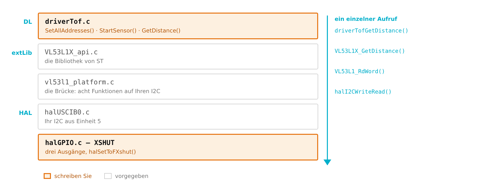

[⬅ Zurück zur Aufgabenstellung](README.md)

# Time-of-Flight-Sensoren am I2C

## Inhalt
- [Laufzeit statt Triangulation](#laufzeit-statt-triangulation)
- [Der VL53L1X](#der-vl53l1x)
- [Drei Sensoren, eine Adresse](#drei-sensoren-eine-adresse)
- [Die Adressvergabe über XSHUT](#die-adressvergabe-über-xshut)
- [Die API von ST und Ihr I2C](#die-api-von-st-und-ihr-i2c)
- [Der Messzyklus](#der-messzyklus)
- [Die API-Funktionen, die Sie brauchen](#die-api-funktionen-die-sie-brauchen)
- [Was vorgegeben ist und was Sie tun](#was-vorgegeben-ist-und-was-sie-tun)

**Unterlagen**
- VL53L1X Datasheet, STMicroelectronics – [Produktseite](https://www.st.com/en/imaging-and-photonics-solutions/vl53l1x.html)
- VL53L1X Ultra Lite Driver (ULD), API-Beschreibung UM2510

---

## Laufzeit statt Triangulation

Der Sharp-Sensor misst geometrisch: Wo trifft der reflektierte Strahl auf den Detektor? Der VL53L1X misst **zeitlich**: Wie lange braucht das Licht hin und zurück?

$$d = \frac{c \cdot t}{2}$$

Bei einem Meter Entfernung sind das 6,7 Nanosekunden. Ein einzelner Puls lässt sich so nicht auswerten – der Sensor sendet deshalb viele Pulse und baut aus den Eintreffzeitpunkten ein **Histogramm** auf. Erst dessen Auswertung liefert die Entfernung. Was dabei intern passiert, ist in der Dokumentation von ST nicht offengelegt und für diese Übung auch nicht nötig.

Die Folgen für die Anwendung sind es sehr wohl:

| | Sharp GP2Y0A02 | VL53L1X |
|---|---|---|
| Messprinzip | Triangulation | Laufzeit |
| Ausgabe | analoge Spannung | Zahl in mm über I2C |
| Kennlinie | nichtlinear, unter 20 cm mehrdeutig | linear, keine Mehrdeutigkeit |
| Messbereich | 20 … 150 cm | 4 cm … 4 m, je nach Modus |
| Messdauer | fortlaufend, ca. 25 … 40 Hz | einstellbares Zeitbudget, 15 … 500 ms |
| Störgröße | Fremdlicht, Reflexionsgrad, Winkel | Fremdlicht, Reflexionsgrad, Abdeckglas |
| Ergebnis ungültig | nicht erkennbar | als Statuscode gemeldet |

Die letzte Zeile ist der eigentliche Unterschied. Der Sharp-Sensor liefert bei einem unbrauchbaren Messwert trotzdem eine Spannung, und dem Zahlenwert sieht niemand an, dass er nichts bedeutet. Der VL53L1X meldet einen **Range Status**, und ein Wert mit Status ungleich null darf nicht verwendet werden.

---

## Der VL53L1X

Drei Einstellungen bestimmen das Verhalten, und sie hängen voneinander ab:

**Distance Mode.** Kurz (bis ca. 1,3 m) oder lang (bis ca. 4 m). Der Kurzmodus ist unempfindlicher gegen Fremdlicht und erlaubt kürzere Messzeiten.

**Timing Budget.** Die Zeit, die der Sensor für eine Messung aufwendet – 15 bis 500 ms. Mehr Zeit heißt mehr Pulse im Histogramm, also weniger Rauschen und mehr Reichweite. Nicht jeder Wert ist in jedem Distance Mode erlaubt; im Langmodus sind mindestens 20 ms nötig.

**ROI (Region of Interest).** Der Empfänger ist eine Matrix aus 16 × 16 SPAD-Zellen. Das Sichtfeld lässt sich auf einen Ausschnitt verkleinern – 16 × 16 entspricht etwa 27°, 4 × 4 etwa 15°.

Am Crazy Car sind die drei Sensoren deshalb unterschiedlich eingestellt:

| | Mitte | Links und rechts |
|---|---|---|
| Distance Mode | lang | kurz |
| Timing Budget | 33 ms | 20 ms |
| ROI | 4 × 4 | 10 × 10 |

Vorne soll der Sensor **weit** sehen, aber eng: Ein breites Sichtfeld erfasst sonst den Boden oder die eigene Aufhängung, und der Sensor meldet dann folgerichtig ein sehr nahes Hindernis. Seitlich ist die Wand nah, dafür soll es **schnell** gehen.

> Die Werte stehen als `#define` in `driverTof.h`. Sie sind ein vernünftiger Ausgangspunkt, keine Naturkonstante – beim freien Fahren dürfen Sie daran drehen.

---

## Drei Sensoren, eine Adresse

Jeder VL53L1X meldet sich nach dem Einschalten unter der **7-Bit-Adresse 0x29**. Bei drei baugleichen Sensoren am selben Bus heißt das: Alle drei antworten gleichzeitig, und auf der Leitung entsteht Unsinn.

Chip Select gibt es bei I2C nicht (siehe [I2C am MSP430](../Kapitel_05_Schnittstellen/I2C.md) aus Einheit 5). Der VL53L1X hat dafür einen **XSHUT**-Eingang:

| XSHUT | Zustand des Sensors |
|---|---|
| **low** | Reset – der Sensor ist am Bus nicht vorhanden |
| **high** | läuft, antwortet auf seine Adresse |

Am Crazy Car hängen die drei XSHUT-Leitungen an gewöhnlichen GPIO-Ausgängen:

| Sensor | Pin | Makro in `halGPIO.h` |
|---|---|---|
| Mitte | P2.2 | `TOF_XSHUT_MID` |
| Rechts | P2.3 | `TOF_XSHUT_RIGHT` |
| Links | P2.4 | `TOF_XSHUT_LEFT` |

**Die neue Adresse überlebt den Reset nicht.** Sie steht in einem Register, nicht im Flash. Nach jedem Einschalten und nach jedem XSHUT-Low muss sie neu vergeben werden – die Adressvergabe gehört deshalb in die Initialisierung und nicht in ein Konfigurationswerkzeug.

---

## Die Adressvergabe über XSHUT

Daraus ergibt sich ein Ablauf, der nur in dieser Reihenfolge funktioniert:

<p align="center">
  
</p>

In Worten:

```
1.  alle drei XSHUT auf low          →  niemand ist am Bus
2.  Sensor 1 auf high                →  nur er antwortet auf 0x29
3.  warten, bis er gebootet hat
4.  ihm die Adresse 0x30 geben       →  0x29 ist wieder frei
5.  Sensor 2 auf high                →  nur er antwortet auf 0x29
6.  warten, Adresse 0x31
7.  Sensor 3 auf high, warten, 0x32
```

Drei Stellen daran sind heikel:

**Das Booten dauert.** Direkt nach der steigenden Flanke an XSHUT antwortet der Sensor noch mit NACK. `driverTofWaitBoot()` fragt deshalb bis zu 100 ms lang den Bootstatus ab und wertet einen NACK nicht als Fehler, sondern als „noch nicht fertig". Ohne dieses Warten schlägt die Adressvergabe sporadisch fehl – und zwar je nach Tagesform des Aufbaus.

**Ein defekter Sensor muss zurück in den Reset.** Antwortet einer nicht, darf er nicht einfach übersprungen werden: Er hängt dann weiterhin mit 0x29 am Bus und stört die Adressvergabe des nächsten. `driverTofSetAllAddresses()` setzt deshalb im Fehlerfall sein XSHUT wieder auf low und merkt sich ein Fehlerbit.

**Die Adresse wird 8-Bit übergeben.** `VL53L1X_SetI2CAddress()` erwartet die Adresse in der um ein Bit nach links geschobenen Schreibweise und schiebt sie intern wieder zurück, bevor sie ins Register geht. Alle anderen API-Funktionen bekommen dagegen die **7-Bit**-Adresse. Deshalb steht im Code genau einmal ein `<< 1`:

```c
VL53L1X_SetI2CAddress(TOF_ADDR_DEFAULT, TOF_ADDR_LEFT << 1);
...
VL53L1X_SensorInit(TOF_ADDR_LEFT);
```

Das ist dieselbe Falle wie in Einheit 5 – nur steht sie diesmal nicht im Datenblatt des Sensors, sondern in der API.

---

## Die API von ST und Ihr I2C

Die Bibliothek von ST heißt **ULD** (Ultra Lite Driver) und kennt keinen Mikrocontroller. Sie formuliert alles als Registerzugriff auf den Sensor und ruft dafür acht Funktionen auf, die die Zielplattform bereitstellen muss:

```c
VL53L1_WrByte()   VL53L1_WrWord()   VL53L1_WrDWord()   VL53L1_WriteMulti()
VL53L1_RdByte()   VL53L1_RdWord()   VL53L1_RdDWord()   VL53L1_ReadMulti()
```

Diese acht Funktionen stehen in `vl53l1_platform.c`, und sie bestehen fast nur aus Aufrufen von **Ihren** Funktionen aus Einheit 5:

```c
halI2CWrite(dev, buf, 2 + count);              // Register schreiben
halI2CWriteRead(dev, reg, 2, data, count);     // Register lesen, mit Repeated Start
while (halI2CBusy());
halI2CError();
```

```
┌──────────────────────────────┐
│  VL53L1X_api.c   (ST)        │   kennt nur Sensorregister
├──────────────────────────────┤
│  vl53l1_platform.c           │   acht Funktionen, eine Schicht dick
├──────────────────────────────┤
│  halUSCIB0.c     (Einheit 5) │   Zustandsautomat, Repeated Start, NACK
├──────────────────────────────┤
│  UCB0-Register               │
└──────────────────────────────┘
```

Das ist der Punkt, an dem sich die Schichtentrennung aus den letzten Einheiten auszahlt. Die Bibliothek eines fremden Herstellers läuft auf diesem Fahrzeug, weil **eine Datei** mit acht kurzen Funktionen sie an Ihren HAL anschließt. Wäre der I2C-Code über den Driver Layer verstreut, gäbe es diese Datei nicht.

Zwei Eigenheiten des Sensors fängt die Plattformschicht dabei ab:

- Die Registeradressen sind **16 Bit** breit und werden als zwei Bytes vorangestellt.
- Der Sensor ist **Big-Endian**, der MSP430 Little-Endian. Mehrbyte-Werte werden deshalb per Schiebeoperation zerlegt und wieder zusammengesetzt.

> `VL53L1_WaitMs()` gehört ebenfalls dazu und ist auf `delayMsBlocked()` aus Einheit 3 abgebildet. Eine blockierende Warteschleife ist in der Initialisierung vertretbar – im Fahrbetrieb wäre sie es nicht, und ab Einheit 8 ist sie es auch nicht mehr.

---

## Der Messzyklus

Nach `VL53L1X_StartRanging()` misst der Sensor **selbstständig weiter**, im Takt des eingestellten Timing Budgets. Der Controller fragt nur noch ab:

```
CheckForDataReady()  ──  nein  ──►  nichts tun, später wiederkommen
        │
        ja
        ▼
GetRangeStatus()  ──  ungleich 0  ──►  Wert verwerfen
        │
        0
        ▼
GetDistance()        Entfernung in mm
        │
        ▼
ClearInterrupt()     quittieren
```

**`ClearInterrupt()` darf nicht fehlen.** Ohne diese Quittung hält der Sensor sein Ergebnis fest und beginnt keine neue Messung. Der Fehler sieht im Debugger danach aus, als stünde das Fahrzeug still: Die Entfernung ist plausibel und ändert sich nie wieder.

Genau diese Abfolge steckt in `driverTofGetDistance()`, mit drei unterscheidbaren Rückgabewerten:

| Rückgabe | Bedeutung |
|---|---|
| `0` | neuer, gültiger Wert steht in `*distance` |
| `1` | noch keine neue Messung fertig – kein Fehler |
| `2` | Messung ungültig, z. B. kein Hindernis in Reichweite |

Der Unterschied zwischen `1` und `2` ist für die Anwendung wesentlich: Bei `1` gilt der letzte Wert weiter, bei `2` ist bekannt, dass dort nichts Verwertbares ist.

---

## Die API-Funktionen, die Sie brauchen

Die ULD von ST umfasst über siebzig Funktionen, und ihre Dokumentation ist knapp. Für diese Einheit brauchen Sie dreizehn davon – hier mit dem, was aus dem Header allein nicht hervorgeht.

Drei Regeln gelten für alle:

- Der erste Parameter `dev` ist die **7-Bit-Adresse** des Sensors. Einzige Ausnahme ist `VL53L1X_SetI2CAddress()`, siehe unten.
- Der Rückgabewert ist `0` bei Erfolg und ungleich null im Fehlerfall. Er meldet den **Übertragungsfehler**, nicht die Messqualität.
- Ergebnisse kommen über Zeigerparameter zurück, nicht als Rückgabewert.

| Funktion | Wofür | Anmerkung |
|---|---|---|
| `VL53L1X_BootState(dev, uint8_t *state)` | ist der Sensor hochgelaufen? | `*state = 1` heißt bereit. Vorher antwortet er mit NACK – der Rückgabewert ist dann ≠ 0 und das ist **kein** Fehler |
| `VL53L1X_SetI2CAddress(dev, uint8_t newAddr)` | neue Adresse vergeben | `newAddr` ist die **8-Bit**-Form, also 7-Bit-Adresse × 2. Ab dem nächsten Zugriff antwortet der Sensor nur noch darauf |
| `VL53L1X_SensorInit(dev)` | Default-Konfiguration laden | dauert rund 50 ms, muss einmal pro Sensor laufen |
| `VL53L1X_SetDistanceMode(dev, uint16_t mode)` | Reichweite | `1` = kurz, `2` = lang |
| `VL53L1X_SetTimingBudgetInMs(dev, uint16_t ms)` | Messdauer | nicht jeder Wert ist in jedem Modus erlaubt – **nach** dem Distance Mode setzen |
| `VL53L1X_SetInterMeasurementInMs(dev, uint16_t ms)` | Abstand zweier Messungen | darf nicht kleiner sein als das Timing Budget; gleich groß = Messungen ohne Pause |
| `VL53L1X_SetROI(dev, uint16_t x, uint16_t y)` | Sichtfeld | 4 … 16 Zellen je Richtung |
| `VL53L1X_StartRanging(dev)` | Dauermessung starten | ab hier misst der Sensor selbstständig weiter |
| `VL53L1X_CheckForDataReady(dev, uint8_t *ready)` | liegt ein neues Ergebnis vor? | `*ready = 0` ist der Normalfall zwischen zwei Messungen |
| `VL53L1X_GetRangeStatus(dev, uint8_t *status)` | taugt das Ergebnis? | `*status = 0` heißt gültig. Alles andere: Wert verwerfen |
| `VL53L1X_GetDistance(dev, uint16_t *mm)` | die Entfernung | in Millimetern |
| `VL53L1X_ClearInterrupt(dev)` | Ergebnis quittieren | ohne diesen Aufruf beginnt **keine neue Messung** |
| `VL53L1X_GetSensorId(dev, uint16_t *id)` | Lebenszeichen | muss `0xEACC` liefern |

> **Die Reihenfolge ist Teil der Information.** Aus den Signaturen geht nicht hervor, dass das Timing Budget vom Distance Mode abhängt oder dass ohne `ClearInterrupt()` nichts weitergeht. Solche Abhängigkeiten stehen in der Anwendungsbeschreibung UM2510 von ST – und das ist der Grund, warum diese Tabelle hier steht.

---

## Was vorgegeben ist und was Sie tun

| | |
|---|---|
| `extLib/VL53L1X/` | die ULD-API von ST, unverändert |
| `vl53l1_platform.c` | die Plattformschicht – setzt die API auf Ihr I2C-Modul aus Einheit 5 |
| `driverTof.c/.h` | der komplette Treiber, inklusive Adressvergabe |

**Ihre Arbeit sind drei Dinge**, und keines davon ist Tipparbeit:

1. die drei XSHUT-Leitungen im HAL schaltbar machen – `halSetToFXshut()`,
2. den Ablauf der Adressvergabe erklären können,
3. nachweisen, dass alle drei Sensoren messen.

Der Treiber ist vorgegeben, weil sein Wert nicht im Tippen liegt: Die Reihenfolge der API-Aufrufe und die Wartezeiten stehen in der Anwendungsbeschreibung von ST, nicht in den Signaturen. Wer sie abschreibt, lernt nichts – wer sie **liest und erklären kann**, versteht, wie man eine fremde Bibliothek in Betrieb nimmt. Darum geht es hier.

`driverTof.h` gibt die Schnittstelle vor, und sie ändert sich nicht – der Fahralgorithmus in Einheit 9 ruft genau diese Funktionen:

```c
void driverTofInit(void);                       // Adressen, Konfiguration, Start
unsigned char driverTofGetStatus(unsigned char sensor);                         // 0 = OK
unsigned char driverTofGetDistance(unsigned char addr, unsigned int *distance); // 0 = neuer Wert
unsigned char driverTofGetSensorId(unsigned char addr, unsigned int *id);       // 0xEACC
```

`driverTofInit()` ruft nacheinander die drei Schritte auf, die oben beschrieben sind:

```c
driverTofSetAllAddresses();     // XSHUT-Sequenz, jeder bekommt seine Adresse
driverTofConfigAll();           // Default-Konfiguration laden, ca. 50 ms pro Sensor
driverTofStartAll();            // Modus, Timing Budget, ROI, Messung starten
```

Lesen Sie `driverTof.c` einmal von oben nach unten, bevor Sie sie einbinden. Zwei Stellen lohnen besondere Aufmerksamkeit: `driverTofWaitBoot()` zeigt, warum ein NACK während des Bootvorgangs **kein** Fehler ist, und `driverTofGetDistance()` zeigt, dass ein Messwert zwei verschiedene Arten von „nicht brauchbar" kennt – noch nicht fertig, und fertig aber ungültig.

**Eine Entwurfsentscheidung ist schon getroffen und sollten Sie beibehalten:** Fällt ein Sensor aus, wird in `tofStatus` sein Bit gesetzt und er in den folgenden Schritten übersprungen – **die beiden anderen laufen trotzdem**. Für ein Fahrzeug, das in einer Übungseinheit funktionieren soll, ist das die richtige Wahl: Ein Wackelkontakt an einem Sensor legt nicht die ganze Initialisierung lahm.

---

[⬆ Zurück zur Aufgabenstellung](README.md)
